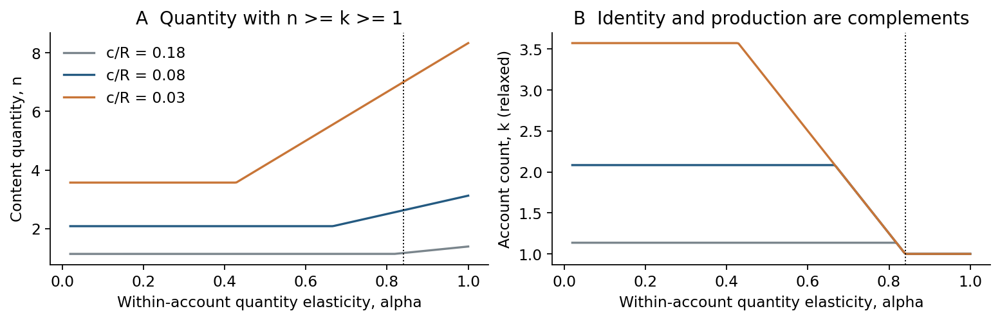
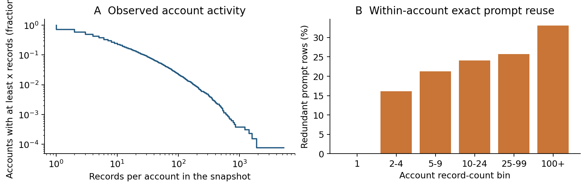
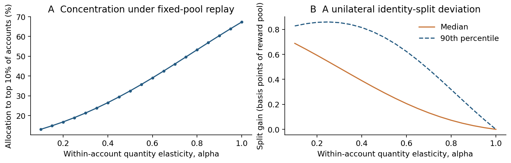

## Abstract

Generative AI can reduce the cost of producing content while audience attention remains scarce. A platform may respond by giving diminishing exposure returns to additional content within an account. We study whether this response reduces production or redirects competition toward additional accounts. A three-player Stackelberg formulation combines a platform's rule choice with two creators' production and identity choices. The continuous benchmark gives a transparent joint implementation condition for an output target and a single-account equilibrium. Adding a minimum content requirement per account reveals a regime in which cheaper production increases both output and account creation. Integer accounts require a separate deviation test. Descriptive analysis uses a historical Civitai metadata snapshot, while a fixed-pool allocation replay illustrates the concentration-manipulation trade-off. The contribution is a course application and preliminary analysis of established contest and false-name ideas, with empirical and theoretical claims kept distinct.

## 1. Research question and motivation

**Research question.** When AI lowers production costs, can a platform use diminishing within-account exposure returns to limit content supply without inducing creators to split their work across accounts?

This question concerns the unit on which a platform applies its incentives. A rule can discourage a large volume of work under one account and nevertheless reward the same work spread over several accounts. The issue is relevant to creator feeds, discovery budgets, and per-account rewards. The proposed rule is hypothetical: we do not claim that Civitai implements it.

We model one platform and two strategic creators. Audience attention enters as a fixed reward pool, so users need not become an additional strategic population. The platform moves first; creators then respond simultaneously. We seek Nash equilibria in the creator subgame and solve a constrained platform design problem by backward reasoning. The central distinction is between an equilibrium that uses one account per creator and a universally false-name-proof mechanism. Our objective is the former.

AI enters through a reduction in production cost. Quality is held constant in the baseline. Thus AI-assisted work can be good or bad, and the model does not assume that AI use means low quality. A change in quality, demand, or the value of attention would be a separate channel.

## 2. Relation to existing research

Yao et al. (2024) use a generalized Tullock contest to study human and generative-AI content competition. Jungbauer et al. (2026, working paper) study AI-induced entry and congestion in quality discovery on attention platforms. Montero-Porras et al. (2026) model co-adaptation between platform incentives and creator effort, including high-quality and deteriorated equilibria. These works make a generic “AI reduces cost and floods a platform” story insufficient as a distinctive project.

Identity manipulation is also established. Mazorra and Della Penna (2023) explicitly allow players to choose costly identities. Brill et al. (2016) study false-name-proof recommendations, and Leshno and Strack (2020) connect splitting invariance with proportional allocation. More recently, Burnat and Davidson (2026, preprint) analyze evidence-backed attribution clusters, duplicate content, and false-name manipulation. Similarity by itself does not establish common ownership.

Our course application connects three quantities: production cost, the curvature of an account-level allocation rule, and identity cost. Its useful outputs are a conditional implementation boundary, the regimes created by a minimum output per account, and a data-grounded illustration of the rule's incentives. We make no priority claim for costly identities, the contest equilibrium, or concavity-induced splitting. Indeed, the unconstrained interior can be reparameterized as a standard Tullock contest; the binding constraints are essential to the interpretation.

## 3. Game definition

There are three players: platform $P$ and creators $i\in\{1,2\}$. The platform commits to $0<\alpha\leq1$, the elasticity of the score with respect to the amount of content within an account. Creator $i$ chooses total content intensity $n_i$ and account count $k_i\geq1$. The initial benchmark treats both as continuous variables and fixes participation.

An account containing intensity $x$ receives score $x^\alpha$. Concavity implies that, for fixed total content and account count, equal allocation across accounts maximizes total score. Hence

$$
s_i=k_i(n_i/k_i)^\alpha=k_i^{1-\alpha}n_i^\alpha.
$$

The creators compete for an exposure reward pool $R>0$. Their utilities are

$$
u_i=R\frac{s_i}{s_i+s_j}-cn_i-\tau(k_i-1),\qquad j\ne i,
$$

where $c>0$ is unit production cost and $\tau>0$ is the cost of an extra account. Parameters are common knowledge, and the platform cannot automatically link accounts to their economic owner. The reward pool represents attention value in common utility units; it is not an observed cash payment. A zero-content account has zero score; no reward is distributed if both creators produce nothing.

At $\alpha=1$, splitting fixed content does not change its score. Smaller $\alpha$ suppresses the return to more work within an account, while increasing the score advantage of distributing that work across accounts. The baseline abstracts from quality choice, entry, heterogeneous ability, and uncertainty about rivals.

## 4. Continuous benchmark and platform design

Let $p_i=s_i/(s_i+s_j)$ and $M_i=Rp_i(1-p_i)$. Against positive rival score, the own-score reward is increasing and concave. Its composition with the concave score, less linear costs, is concave in the creator's choices. The correct production derivative is

$$
\frac{\partial u_i}{\partial n_i}
=\frac{Rs_j}{(s_i+s_j)^2}\frac{\alpha s_i}{n_i}-c.
$$

The first-order conditions give $cn_i=\alpha M_i$ and, for $k_i>1$, $\tau k_i=(1-\alpha)M_i$. The boundary $k_i=1$ requires $\tau\geq(1-\alpha)M_i$. Because there are two creators, $M_1=M_2$. The identical optimization conditions imply identical choices, so each receives half the reward.

**Proposition 1.** In the continuous-intensity benchmark,

$$
n^*=\frac{R\alpha}{4c},\qquad
k^*=\max\left\{1,\frac{R(1-\alpha)}{4\tau}\right\}.
$$

Lowering $\alpha$ reduces output but can increase identity investment. Lowering $c$ at a fixed rule increases output; in the unconstrained interior it leaves the account count unchanged. This last result is conditional, not a claim that AI cannot increase account creation.

The interior's simple form has a standard explanation. Put $e_i=cn_i+\tau k_i$. Score maximization at fixed expenditure gives $n_i=\alpha e_i/c$ and $k_i=(1-\alpha)e_i/\tau$. The resulting score is a common constant times $e_i$, which cancels from relative shares. Utilities reduce to $Re_i/(e_i+e_j)-e_i+\tau$, a standard two-player contest. Consequently, changing curvature can reallocate rent-seeking expenditure between production and identities without reducing its total.

**Proposition 2.** For a target $\bar n>0$, the benchmark can implement $n^*\leq\bar n$ and $k^*=1$ exactly when

$$
c\bar n+\tau\geq R/4.
$$

The proof is the intersection of $\alpha\leq4c\bar n/R$ and $\alpha\geq1-4\tau/R$, with $0<\alpha\leq1$. This is an equilibrium implementation condition, not protection against every possible false-name deviation at every strategy profile.

To close the platform's first move, let verification intensity $v\geq0$ increase identity cost from $\tau_0$ to $\tau_0+v$. The platform minimizes $K(v)=\kappa v^2/2$ subject to its output target and single-account equilibrium. It needs

$$
v_{\min}=\max\{0,R/4-c\bar n-\tau_0\}.
$$

The target may represent a curation budget. This objective is constrained implementation cost, not a solved profit or welfare optimum. The conversion from verification intensity to private identity cost is an explicit policy assumption.

## 5. Minimum output and integer accounts

A relaxation that permits arbitrarily many accounts with arbitrarily little content misses an important complementarity. Require $n_i\geq k_i\geq1$: every active account must carry at least one normalized output unit. Keep both variables continuous initially and write $A=R/4$.

**Proposition 3.** The constrained continuous equilibrium is

$$
k^*=\max\left\{1,\min\left[\frac{A(1-\alpha)}{\tau},\frac{A}{c+\tau}\right]\right\},
\qquad n^*=\max\{k^*,A\alpha/c\}.
$$

The KKT conditions at symmetry are $A\alpha/n-c+\lambda=0$ and $A(1-\alpha)/k-\tau-\lambda+\mu=0$, where $\lambda(n-k)=0$ and $\mu(k-1)=0$. At any two-player equilibrium the same $M=Rp_i(1-p_i)$ enters both players' conditions. These conditions correspond to the same strictly concave log-score expenditure problem, implying symmetry. Checking its boundary cases yields the formula.

Splitting occurs exactly when $\tau<A(1-\alpha)$ and $c+\tau<A$. Conditional on the first inequality, a reduction in $c$ passes through three regimes:

| Cost range | Equilibrium | Interpretation |
|---|---|---|
| $c\geq A-\tau$ | $n=k=1$ | Production is too costly to support expansion. |
| $\alpha\tau/(1-\alpha)\leq c<A-\tau$ | $n=k=A/(c+\tau)$ | Each extra account needs extra content; both expand. |
| $c<\alpha\tau/(1-\alpha)$ | $n=A\alpha/c$, $k=A(1-\alpha)/\tau$ | The minimum-output constraint is slack. |



The output-target condition survives with the additional requirement $\bar n\geq1$. Integer identities still require separate analysis. Against the symmetric single-account candidate $n_1=\max\{1,A\alpha/c\}$, put $S=n_1^\alpha$ and define

$$
V(k)=\max_{n\geq k}\left[R\frac{k^{1-\alpha}n^\alpha}{k^{1-\alpha}n^\alpha+S}-cn\right].
$$

Partial maximization preserves concavity of $V(k)$. Its secant slopes from $k=1$ decrease, so checking the two-account deviation suffices. The exact integer-account threshold for the single-account profile is

$$
\tau_{\mathrm{int}}=\max\{0,V(2)-V(1)\}.
$$

For $R=4$, $\alpha=0.5$, $\tau=0.2$, enumeration gives integer equilibria $(n,k)=(1,1)$ at $c=0.6$, $(2,2)$ at $c=0.3$, and $(5,3)$ at $c=0.1$. At $c=0.18$, the bounded numerical enumeration finds no pure equilibrium; the minimum candidate deviation gain is approximately $5.2\times10^{-6}$. This illustrates a limitation of simply rounding a continuous solution, rather than proving a general nonexistence theorem. Output remains continuous in this extension.

## 6. Data and descriptive evidence

We downloaded metadata only from the public, non-gated `thefcraft/civitai-stable-diffusion-337k` snapshot, pinned to commit `758d4d72c87c5177c349230f38f2e8e8e3b6a23c`. The 164,627,773-byte Parquet file was obtained directly on HKUST3 through a public mirror; its SHA256 matched the source LFS hash. No image was downloaded. The historical records span 9 November 2022 to 12 April 2023, so they cannot establish a 2026 policy effect.

The source has 327,138 rows. Retaining the first occurrence of each image ID removes 1,539 duplicates, leaving 325,599 unique images. There are 185,004 records with the source's SFW boolean. After requiring a nonempty author name, the analytical pool contains **184,072 records from 12,910 accounts**. The source flag is used as an inclusion rule, not as an independently validated content assessment. Missing authors are excluded from account analysis.

Account counts are highly unequal: the median is 3 records, the 90th percentile 28, and the maximum 5,259. These are within-snapshot counts, not complete author production histories. A fixed-seed random sample of 10,000 SFW records and a separate 1,000-account stratified sample were also saved remotely for reproducibility; the aggregate analysis below uses the complete eligible snapshot.

Prompt normalization uses Unicode normalization, case folding, whitespace collapse, and trimming. Of the eligible records, 151,833 have nonempty prompts. There are 41,487 excess prompt records within the same account, or **27.32%** of prompt-bearing records. A repeated prompt can represent seed variation or a legitimate series; it is not an image duplicate, plagiarism finding, ownership link, or quality score. Larger account bins show more prompt reuse, partly because they contain more opportunities to repeat.



Only 12.39% of eligible records have a nonzero count of the tracked reactions; the median and 75th percentile are zero. Engagement capture time is unknown. Consequently, we do not estimate quality, creator revenue, or a causal quantity-engagement relationship from these counts.

## 7. Fixed-pool mechanism replay

For each observed account $a$, let $n_a$ be its eligible record count. A hypothetical rule assigns $p_a=n_a^\alpha/\sum_b n_b^\alpha$. We replay this rule on the same fixed pool, then allow one account with at least two records to divide them as evenly as possible between two nonempty accounts. Both creators and their content are held fixed in this exercise; no production response or real recommender is estimated.

| Quantity elasticity | Top 10% allocation share | Top 1% allocation share | Median unilateral split gain |
|---|---:|---:|---:|
| $\alpha=1$ | 67.33% | 28.48% | 0 basis points |
| $\alpha=0.5$ | 32.49% | 7.05% | 0.293 basis points |
| $\alpha=0.25$ | 18.94% | 2.83% | 0.542 basis points |

One basis point is $10^{-4}$ of the total normalized reward pool. The split gains are gross of account costs and summarized over 9,341 eligible accounts. A small absolute share can be meaningful relative to an individual account's original share; it does not establish that real people would create another account.

At $\alpha=0.5$, the median gain is 41.41% of the deviating account's initial hypothetical share. This is a gross allocation gain for unchanged work, not a prediction of net profit.



The replay illustrates the same policy tension as the game: allocation can look more balanced while the identity on which the balancing operates remains manipulable. This is a model-based observation using the empirical distribution of record counts. It is not evidence that the platform uses this rule, that these accounts are controlled by the same owner, or that a policy would cause the plotted changes after adaptation.

## 8. What the preliminary analysis establishes

The project formulates a tractable platform-creator problem and solves its continuous subgames, a constrained platform design problem, and an integer-account deviation test. The minimum-output constraint is substantively useful: an AI-related cost reduction can increase account creation in the boundary regime even though it does not do so in the unconstrained interior. Data demonstrate unequal account activity and prompt reuse, and make the hypothetical allocation exercise concrete.

The costs $c$ and $\tau$, reward value $R$, and actual recommendation elasticity are unobserved. Parameter illustrations are therefore scenarios, not estimates. The historical sampling frame and engagement capture time cannot be independently reconstructed. Usernames identify accounts, and neither prompt overlap nor public metadata reveals their latent owners. Content quality, entry, verification errors, and the burden on genuine new creators are outside the solved model. A useful next extension would compare identity costs with probabilistic identity aggregation while accounting for false merges; it is not needed for the present preliminary result.

**Data and code availability.** Raw metadata and derived row-level samples remain on HKUST3. The source card does not declare a license, so this project redistributes no raw records or images. Reproduction scripts, assumptions, aggregate summaries, and figures are provided separately. Analysis is observational and uses public metadata; no individuals were contacted. Funding and conflict-of-interest information was not supplied for this preliminary exercise. AI tools assisted literature discovery, drafting, and mathematical review; automated review was checked against explicit derivatives and numerical deviations.

```{=typst}
#pagebreak()
```

## References

Brill, M., Conitzer, V., Freeman, R., & Shah, N. (2016). *False-name-proof recommendations in social networks*. AAMAS. [Proceedings text](https://www.ifaamas.org/Proceedings/aamas2016/pdfs/p332.pdf).

Burnat, F. A. D., & Davidson, B. I. (2026). *Quotient semivalues for false-name-resistant data attribution*. Preprint, v2. [arXiv:2605.07663](https://arxiv.org/abs/2605.07663).

Jungbauer, T., Li, C., Wu, X., & Xiao, F. (2026). *The disruption of attention platforms by generative AI*. Working paper; model comparison based on the original abstract. [SSRN](https://papers.ssrn.com/sol3/papers.cfm?abstract_id=6521778).

Leshno, J. D., & Strack, P. (2020). Bitcoin: An axiomatic approach and an impossibility theorem. *American Economic Review: Insights, 2*(3), 269-286. [doi:10.1257/aeri.20190494](https://doi.org/10.1257/aeri.20190494).

Mazorra, B., & Della Penna, N. (2023). *The cost of Sybils, credible commitments, and false-name proof mechanisms*. Preprint, v3. [arXiv:2301.12813](https://arxiv.org/abs/2301.12813).

Montero-Porras, E., Smets, A., & Lenaerts, T. (2026). Enshittification of algorithmic recommendation: An evolutionary model of platform-creator dynamics. *HHAI 2026*. [doi:10.3233/FAIA260512](https://doi.org/10.3233/FAIA260512).

Thefcraft. (n.d.). *Civitai stable diffusion 337k* [Metadata dataset; accessed 4 November 2026; pinned commit above; actual source row count 327,138]. [Dataset card](https://huggingface.co/datasets/thefcraft/civitai-stable-diffusion-337k).

Yao, F., Li, C., Nekipelov, D., Wang, H., & Xu, H. (2024). Human vs. generative AI in content creation competition: Symbiosis or conflict? *Proceedings of ICML, PMLR 235*, 56885-56913. [Proceedings](https://proceedings.mlr.press/v235/yao24b.html).
