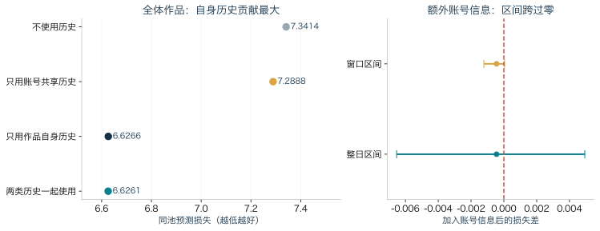
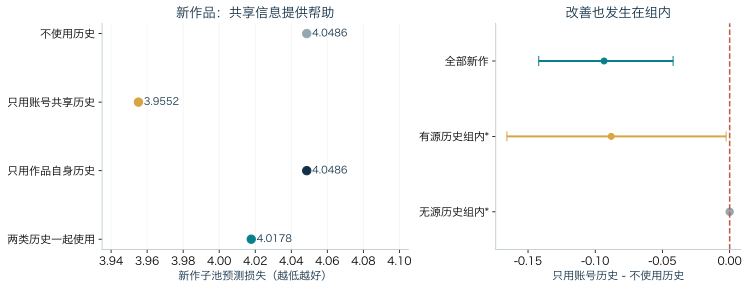

# 旧作品、账号信息与新生产：内容平台的曝光实验与创作者博弈

**摘要**　本文研究内容平台的未来曝光能从哪些历史信息中预测，以及这些信息对创作者竞争模型有什么启发。我们用真实曝光记录比较四种方法：不使用历史、只使用作品自身历史、只使用同账号其他作品的历史、同时使用两类历史。结果显示，作品自身历史带来主要预测改善；在此基础上加入账号共享信息，平均改善很小且不稳定。对没有自身历史的新作品，共享账号信息则有一定帮助。一个小型公开 YouTube 样本也显示作品历史有预测价值。根据这一信息区分，我们建立了含旧作品存量与账号积累的两期生产博弈，并求解若干给定情景：旧作品可以挤出新增生产，而考虑未来状态会改变今天的选择。AI 降本和多账号是研究背景；真实拆号行为、成本冲击和平台最优规则仍需另外检验。

**关键词**：曝光预测；作品记忆；账号共享信息；创作者博弈；旧作品存量

## 1 研究问题、背景与实际贡献

设想一位创作者已经发布了很多作品，今天即使不更新，旧作品也可能继续获得展示。另一位创作者刚发布第一部作品，还没有这部作品的历史记录。平台如何分配曝光，不能只看两人今天各发了多少。已有作品的持续吸引力、创作者的稳定能力、账号积累的受众信息，都可能影响未来的分配。

这种区分也关系到 AI 背景下的策略问题。如果制作内容更便宜，创作者是否会增加生产？如果平台削弱同一账号多发作品的奖励，创作者是否会转向多账号？要分析这些行为，先要弄清楚曝光与哪些信息有关，避免把旧作品已经获得的流量，直接当成再制作一部新作品的回报。

本文回答两个相互衔接的问题：

1. **实验问题：**作品自己的过去表现、同账号其他作品的过去表现，各自能帮助预测多少未来曝光？新作品没有自身历史时，答案是否不同？
2. **博弈问题：**在明确给定的平台规则下，如果旧作品可以继续参与推荐、账号状态也会积累，两位创作者应怎样选择本期生产？允许开新号时，又多出什么权衡？

我们完成了两项工作。第一，用同一批候选作品和同一信息截止，比较不同历史来源，并把新作品单独检验，识别出这些信息各自适用的预测对象。第二，把旧作品存量、账号状态与新增生产分别写入两期博弈的若干可求解情景，分析当前选择为何会受未来影响。

两项工作的证据不同：真实数据检验预测信息，理论模型分析给定假设下的策略。数据中确实存在旧作品继续获得曝光的记录，但没有真实经济主体的多账号映射、AI 采用成本或平台规则变化。因此，本文完成的是曝光信息的区分和条件性的策略分析，尚未验证 AI 导致拆号的因果链。模型沿用已有的内容创作竞赛与存量分析工具，不主张创立新的基础博弈理论。

## 2 概念、术语与一个贯穿例子

### 2.1 阅读顺序

先把“作品”“账号”“创作者本人”分开，再看两类历史信息。下列术语表给出本报告的用法；随后用一个假设例子演示，如何从历史信息得到预测份额。

### 2.2 术语表

表 1 只放正文反复使用的测量与实验术语；表 2 放博弈符号。

| 术语 | 本文定义 |
|---|---|
| 曝光 | 某作品某日被记录的展示次数；KuaiRec 用 `show_cnt`，外部源用 `impressions` |
| 独立观众与点赞 | 独立观众是去重人数；点赞是互动计数 |
| 曝光份额与曝光总量 | 份额是同一候选池内该作品/账号曝光占池内总曝光比例；条件份额是在指定子池内重新归一化后的份额；总量是计数 |
| 历史曝光份额 | 过去某段时间，一个账号的曝光占当时同一候选池总曝光的比例。例如总曝光一万次、其中两千次属于该账号，历史份额就是20%。它不是下面两个历史权重 m、h 的别名。 |
| 曝光权重 | 评分时按实际曝光数加权；总权重是计数之和 |
| 候选池 | 某日源表实际有记录的作品集合 |
| 作品、账号、经济主体 | 作品是内容单位；账号是作者标识；经济主体是真正控制账号的人或组织 |
| 旧作品、新作品、新账号 | 旧作是上传后仍被记录；新作是日期等于上传日的上传自然日；新账号是注册意义上的新号 |
| 作品记忆 m | 目标作品过去实际曝光相对于基准期望曝光的比值。记录少时向1平滑，避免少量曝光产生极端权重；旧记录每过7天权重减半，这个设定称为7日半衰期 |
| 账号共享信息 h | 同账号不相交源作品的同类残差比，同样在样本少时拉向 1；同日同账号目标作品共用 |
| 基准 e | 用训练期记录估计的同年龄、同时长作品的平均曝光；年龄指距发布日期的天数。用 $\bar e$ 表示训练全局平均曝光 |
| 交叉熵 | 曝光加权的负对数预测份额；模型给实际曝光作品的份额越低，惩罚越大。单位奈特（nats，信息量单位），越低越好 |
| 联合损失与条件损失 | 联合把分给子池之外作品的概率也计入；条件只在指定子池内重新归一化。两者回答不同问题 |
| 预测关联与因果效应 | 预测关联用t 日前信息预测 t 日曝光；因果效应需外部给定的变化 |
| 真实离线预测实验与数值情景 | 前者用真实历史做留出预测（留出一段数据不参与选参数，只用于最后评分）；后者给定参数求解模型 |

| 符号 | 含义 |
|---|---|
| B | 仍可参与推荐的旧作品有效存量，按标准化内容单位计 |
| H | 附着于账号、可能随曝光积累的状态；本文作为假设 |
| θ | 可能随创作者转移的持续能力或题材匹配 |
| x | 本期新增的标准化内容强度；连续模型可以取小数，不直接等于视频条数 |
| 评分 S 与 α | S 是竞争积分；$\alpha$ 控制内容增加带来多少积分：1为同比增加，小于1为新增奖励递减。$w(H)=(1+H)^b$ 中的 $b\geq0$ 控制账号状态影响强弱。预测指数与理论规则没有被因果校准为同一参数 |
| p 与 R | p 是曝光份额；R 是把全部曝光折算成收益的总盘子 |
| c、F、μ | c 为单位生产成本；F 为一次性开户费；μ 为每期额外账号维护费。它与测量部分的平均曝光 $\bar e$ 无关 |
| ρ_B、δ_H、λ_H | ρ_B 是旧内容保留比例；δ_H 是账号状态保留比例；λ_H 控制曝光份额对下一期账号积累的影响，均是模型假设参数 |
| χ | 贴现因子，未来一单位效用折合今天多少 |
| 前瞻、短视与子博弈精炼均衡 | 前瞻考虑未来状态与对手反应，短视只优化当期。纳什均衡指对方策略不变时，任何一方单独改策略都不能提高收益；子博弈精炼还要求偏离后各局面中的继续策略也满足这一条件 |

### 2.3 一个贯穿例子（解释性假设数据）

设账号 a 有两类作品：来源组 S_a 是两部旧作，只用于构造共享信息；目标组是明天候选池中的 A、B 和新作 C。账号 b 同理，来源组 S_b 构造 h_b，目标是 D。S_a 与 {A,B,C} 不相交，S_b 与 {D} 不相交。现实中的 A/B 是两个作品组，每组可以有很多作品；这里只列四部作品。

假定已经过 7 日半衰期和 7 个作品日先验调整后，目标作品的基准与记忆如下；m 是平滑后的权重，不是把某天曝光直接除以当天基准。

| 目标作品 | 账号 | 基准分值 e | 记忆 m（假定已平滑） |
|---|---|---:|---:|
| A | a | 400 | 2.0 |
| B | a | 200 | 0.5 |
| C | a | 200 | 1.0（无自身历史） |
| D | b | 300 | 1.0 |

基准分值可以统一缩放而不改变份额，因此例子省略共同的平均曝光除数。先只用作品记忆，取 α=1、γ=1，分数 z=e×m：A 为 800，B 为 100，C 为 200，D 为 300，总和 1,400；份额分别为 57.1%、7.1%、14.3%、21.4%。如果当天总曝光是 1,400，预测曝光就是 800、100、200、300；实际评价不会把当天总曝光当输入，这里乘 1,400 只是把份额翻译成直观数字。

再加入共享信息。设从 S_a 估出 h_a=1.5，从 S_b 估出 h_b=1.0，取 β=1。共享项对同一账号的所有目标作品是公共的：A 变为 1,200，B 为 150，C 为 300，D 为 300，总和 1,950；份额变为 61.5%、7.7%、15.4%、15.4%。账号 a 的总份额上升，D 的份额下降；但在账号 a 内部，A:B:C 仍是 800:100:200，也就是 1,200:150:300，相对份额完全不变。这就是为什么在单频道日份额里，公共 h 会约掉：它改变账号之间的分配，不改变同一账号内部作品之间的分配。

新作品 C 的特殊之处在于 m_C=1，它没有自己的过去，只能利用账号 a 的共享信息。h_a 高时 C 的份额从 14.3% 升到 15.4%，h_a 低时 C 会被压低；但 h_a 不能告诉我们在账号 a 内部 C 是否比 A/B 更好，那需要作品层特征或后续记录，公共 h 本身不能区分。若把 C 搬到新账号，h_a 是否跟随没有任何观测；模型里的新账号 B=H=0 是制度假设，不是“换号就丢资本”的经验事实。

操作顺序是：先把目标作品的过去记录变成作品权重，再从不相交来源组构造账号权重；合成评分后，在当天候选池内归一化成预测份额。这个操作不需要预知当天的实际总曝光。

## 3 数据与实验设计

### 3.1 数据与候选池

主数据是公开的 KuaiRec 短视频曝光记录（Gao 等，2022），覆盖 2020-07-05 至 09-05，共 343,341 个作品日、10,728 部作品、8,369 个账号。一个“作品日”是一部作品（`video_id`）在某天的一条记录，账号标识是 `author_id`；`show_cnt` 是当天曝光。缺失日不补零：只有当天源表里实际有记录的作品才进入候选池，没有记录不等于真实零曝光。因此候选池是“条件于来源观察池”的集合，不是全平台可推荐库存。

外部补充是 OpenChannelStats 上频道主自愿公开的逐日曝光。公开清单有 7 个入口，6 个非空，4 个达到预定覆盖门槛；测试期共有 960 个视频日、7,824 次曝光。它是第三方公开记录，不是 YouTube 官方随机样本，只用于有限复制，不与 KuaiRec 混成同一张表。

### 3.2 时间切分与信息截止

按作品标识做固定分组，把作品分成 A/B 两组；A 组的历史用于构造账号共享信息、预测 B 组，再反向一次。目标作品的 m 只用目标作品自己在 t 前的记录；h 只用同账号、与目标作品不相交的来源组。两方向复用同一批数据，不是独立复制；目标作品互斥。

每个方向有四个起点；训练窗在前用于拟合，校准窗居中用于选参数，测试窗在后只用于评分，分别为 14、7、7 天。t 日的特征只读取 t 之前的记录；先评分，再观察 t 日曝光，然后把它并入 t+1 日的状态。测试期逐日更新只用已经发生的前一日反馈，预测时属于过去，不是泄露未来。参数只在 7 天校准期选择，测试期只评分。四个起点的测试窗互不重叠，共28个不同测试日；部分训练、校准期及后一起点可使用的过去记录会重用。

### 3.3 四个嵌套评分族

四个评分族共用同一年龄/时长基准、同一候选池和共同的数量指数候选范围：

- 无状态：只用年龄/时长基准；
- 仅作品：加入目标作品自己的记忆 m；
- 仅账号：加入同账号共享信息 h；
- 双状态：同时加入 m 和 h。

评分先把基准和作品记忆结合，再用账号信息调整：

$$z_v=\frac{e_v}{\bar e}m_v^\gamma,\qquad T_a=\sum_{v\in a}z_v,\qquad s_v=h_a^\beta T_a^{\alpha-1}z_v.$$

同账号汇总为 $\sum_{v\in a}s_v=h_a^\beta T_a^\alpha$；预测概率为目标作品评分除以候选池评分总和。其中 γ 是作品记忆的幂次，β 是共享信息的幂次，α 是账号总权重的幂次。α 在 {0.5,0.75,1} 中选，γ 和 β 在 {0,0.5,1} 中选；无状态、仅作品、仅账号、双状态分别有 3、9、9、27 个设置。四个族都用 T_a 汇总同账号目标作品权重，所以“仅作品”不是单独把 m 放进一个线性公式，而是项目定义的一个评分族；主比较中两族的 T 算法相同，新增的只有 h。这个评分式只是预测形式与理论形式的对应，不表示库存或资本转移已被估计。

候选池是当天源表实际有记录的目标作品；观测份额用池内实际曝光总和作分母；预测份额则用池内评分总和作分母。实际总曝光不作为预测输入，只在评价时给每个作品日加权。总权重 14,009,144,990 是计数之和，不是 140 亿个独立样本。测试规模为每个模型 190,568 个作品日、8,107 个观察账号，其中 19 个零总曝光账号保留。

### 3.4 校准与区间

四个族都在校准期选参数，测试期不再改。95% 区间有三种重复抽样：按整日配对、以整个测试窗为块、固定预测按账号整块。它们都不重拟合，衡量的是固定预测下的抽样敏感性，不是因果置信区间，也不覆盖观看者与时间之间的全部依赖。

### 3.5 这套设计能回答与不能回答什么

这套设计能回答的是：在 t 日前可用的信息中，哪一种历史来源能帮助预测 t 日曝光。它不能回答：如果平台改变规则、给某个作品更多曝光，会发生什么。数据没有经济主体映射、注册时点、迁移记录、AI 采用或成本变化，也没有排序规则冲击；因此不能把 h 直接叫不可转移资本，不能把预测选出的 α=1 叫平台线性，不能把新作品叫新账号，也不能把旧作品持续曝光叫状态转移已被验证。缺失日不是零曝光，候选池也不是全平台。这些边界是研究设计的一部分，后文只在具体结果处点明含义，不再逐段重复。

## 4 主要实验结果

### 4.1 全体作品：作品记忆是主，账号信息是次

这一小节回答：目标作品自己的过去是否有预测信息，控制它之后同账号共享信息还有多少增量。输入是上述 343,341 个作品日；预测目标是同一候选池内下一段测试期的曝光分配；对照是四个评分族；评分是曝光加权的视频联合交叉熵，越低越好。四族在同一候选池、基准和校准规则下比较，测试期只评分。

| 评分族 | 视频联合交叉熵 | 相对无状态 | 相对仅作品 |
|---|---:|---:|---:|
| 无状态 | 7.341395 | — | — |
| 仅作品 | 6.626575 | −0.714820 | — |
| 仅账号 | 7.288813 | −0.052582 | +0.662238 |
| 双状态 | 6.626127 | −0.715268 | −0.000448 |

结果有三层。第一，目标作品自己的过去很有信息：仅作品族相对无状态改善 −0.7148，日期区间 [−0.7839,−0.6499]，不含零。第二，仅账号相对无状态也有 −0.0526 的改善，区间 [−0.0651,−0.0402]，说明账号信息并非完全无用；但它远小于仅作品族的增益，单独使用仍远差于仅作品。第三，控制作品记忆后，双状态相对仅作品的总体增量只有 −0.0004484，日期区间 [−0.0065349,+0.0049345]、起点区间 [−0.0012171,+0.0000432]、账号区间 [−0.0189637,+0.0157660]，三种区间都跨零。与 −0.7148 相比，这个数在量级上小约三个数量级；但两者不是同一个比较，不能据此做百分比归因。

这里的 190,568 个测试作品日包含 4,315 部新作品，不是“只含旧作品”的样本；旧作品占多数是样本构成，不是筛选条件。

{width=100%}

图 1 左图是四个评分族在同一候选池上的预测损失，横轴越低越好；右图是“加入账号信息后的损失差”，即双状态减仅作品。图中两条横线分别是整日配对区间和起点窗口区间，正文还报告账号聚类区间；三种区间都跨零，表示这个平均增量在重复抽样下不稳定。区间均为固定预测下的重复抽样，不是因果置信区间。图源：本项目预测评估汇总。

### 4.2 平均增量很小，而且集中

这个总体小增益对高曝光账号敏感。固定预测、仅去除曝光最高一个账号的评分贡献后，差值便从负转正；这不是把该账号从市场移走，也没有重新拟合模型。因此，不能把总体平均改善说成所有账号都受益。

不相交来源历史只覆盖26.04%的测试作品日、41.42%的曝光，限制了共享信息能用于哪些作品。无源历史时 h 回先验1，不新增个体信息，但其他账号的 h 仍会通过全池归一化改变其预测份额，不能把总体增量小仅归因于“稀释”。预定总体比较应当保留；新作品检验另回答没有自身历史时的信息价值。

### 4.3 新作品：共享信息有用，但复杂模型未必最好

这一实验问：没有作品自身历史时，同账号其他作品的信息是否有帮助？输入是4,315部实际有上传自然日记录的新作品，作品记忆 m 回到先验1；共享信息 h 只来自不相交来源作品的过去记录。我们把四种方法在这些新作品上的预测概率重新归一化，比较新作之间的曝光分配，而不把新旧作品总份额混在同一个问题里。

| 方法 | 新作品子池内预测损失 |
|---|---:|
| 不使用历史 | 4.048581 |
| 只用作品自身历史 | 4.048581 |
| 只用账号共享历史 | 3.955176 |
| 两类历史一起用 | 4.017787 |

仅账号相对无状态改善−0.0934049，日期95%区间为[−0.1420583,−0.0420770]，不含零。它是四种方法中新作预测最好的；双状态反而比仅账号差。这说明没有自身历史的新作品可以利用同账号其他作品的信息，但增加更多特征并不保证测试表现更好。这里与上一表的候选池不同，不能直接横比两表损失的绝对大小。

这项改善会不会只是模型给“有来源历史”这一组多分了一些概率？结果后固定预测诊断将其拆开：710部有源历史新作的组内损失从2.526059降到2.437922，差−0.0881376，日期区间[−0.1657274,−0.0026242]；3,605部无源历史新作使用共同先验，组内差约零。总改善−0.0934049中，约−0.0494430来自两组之间的份额，约−0.0439620来自加权组内分配。

因此，改善不全是组间校正，有源历史组内部也有信息。去掉几个高曝光账号的评分贡献后仍有改善，但这项分解是看过主结果后的诊断，不是独立确认；它也不能区分稳定能力、题材匹配与不可转移的账号资本。

{width=100%}

图2：左图比较同一新作子池的四种方法，越低越好。右图比较“仅账号减无状态”：全部新作与有源历史组内的区间在零左侧；无源历史组内差为零。星号表示结果后固定预测诊断，不是额外的独立实验。

### 4.4 两个负面结果：α 全选 1，一步预测不胜前日

四个评分族在 8 个校准单元中共有 32 次 α 选择，候选为 {0.5,0.75,1}，32 次全部选 1。这是重要的负结果：在当前有限参数范围、当前候选池和当前评分族中，校准没有选择凹数量形式。它不表示平台真实 α=1，也不表示凹规则不可能起作用；它只说明本轮数据没有支持“现实推荐按凹数量奖励”这个初始前提。把预测参数当成平台因果弹性，是把模型调参误读成制度估计。

我们还尝试预测下一日曝光的水平。加入更多观测状态与目录特征，没有超过直接沿用前一天表现的简单基准。这项失败说明，增加状态特征并未改善该短期预测任务；模型中的库存和资本转移方程仍是理论假设，不能用观测记忆的更新定义来证明它们。

### 4.5 外部小源：复制了作品记忆，但没有复制账号资本

这一小节回答：作品记忆是否只是 KuaiRec 候选池的假象。输入是 4 个合格频道的 960 个测试视频日、7,824 次曝光，测试窗为 2026-10-27 至 11-02；预测目标是频道内当日份额；对照是年龄基准、年龄×记忆（年龄基准乘作品记忆）、前日加先验（前日有记录就用前日曝光加一，否则回年龄基准）；评分是频道内条件交叉熵。每个频道独立划分 14/7/7 日，缺失不补零，合并只汇总评分，不假设频道共享市场。

| 方法 | 四频道合并条件评分 |
|---|---:|
| 只用作品年龄 | 2.328489 |
| 年龄基准加作品历史 | 1.818669 |
| 直接用前日曝光加先验 | 1.718326 |

年龄×记忆相对年龄改善 −0.509820，日期区间 [−0.569385,−0.440325]；四个频道的点估计方向都改善，固定评分去掉 koura 后仍为 −0.326295。但更简单的前日加先验为 1.718326，比年龄×记忆的 1.818669 更好；koura 一个频道占 73.63% 的权重。这是有限外部一致性，不是平台普遍规律。

更重要的是，这个外部源不能复制账号资本或 α。频道内日份额里，同一频道所有作品共用的 h^β 和 T^(α−1) 会在归一化中约掉；没有多账号共享状态，也没有共同完整市场预算。它能说明“目标作品自己的过去在另一个来源也有预测价值”，不能说明“账号资本被复制”。

## 5 给定平台规则下的创作者博弈

### 5.1 模型对象、时序与符号

理论部分回答：如果旧作品仍可推荐、账号状态会积累，给定平台规则，两位创作者会怎样选择本期生产和开号。平台先承诺推荐规则，假设双方知道规则、状态和成本；两位创作者同时行动；平台不是本文求解的战略玩家，观众也不是。每位创作者已有旧账号，可选择本期生产 x、是否开新号、如何在账号间分配内容。旧作品仍参与推荐；已有账号可以零生产；新号首期至少生产一件。收益是曝光带来的效用减去生产成本，再减去开户与维护成本；两期收益按贴现因子相加。这里的效用按曝光份额折算，不是观看者福利，也不是现金收入。

表 2 已给出符号。单账号的核心式是：

$$S_i=\theta_i w(H_i)(B_i+x_i)^\alpha,\qquad w(H)=(1+H)^b,\ b\geq0.$$

$$p_i=\frac{S_i}{S_i+S_j},\qquad u_i=Rp_i-cx_i.$$

$$B_i'=\rho_B B_i+x_i,\qquad H_i'=\delta_H H_i+\lambda_H p_i.$$

多账号时，总评分和总份额分别是各账号之和；开号还要付一次性 F 和每期 μ。模型假设新号 B=H=0，w(0)=1；b=0 是“账号状态不影响评分”的模型内对照。评分 S 不是收益，p 不是现金收入，B/H 不是本期生产。把 S 当收益会把曝光当收入；把 B 当本期生产会把旧作流量当新作回报；把 H 当已证实资本会把假设当估计。这三件事必须分开。

平台规则、成本、保留率和反馈系数都是情景参数，不是从曝光数据估计的。数据能告诉我们哪种预测指标值得写进模型，不能告诉我们真实的 B/H 转移率、开户费或平台 α。这条存量—流量思路与 Sun 和 Sun（2026）的创作者粉丝存量研究相邻，但本文的 B/H 是情景状态，不是用其数据估计出来的。

### 5.2 一期切片：旧作足够多时，零新生产可以是均衡

先看固定状态、禁止新增账号、两人条件相同的连续生产切片，假设 $R,c>0$、$0<\alpha\leq1$，且产能上限不约束。两位创作者条件相同，均衡份额 p=1/2；对本期生产求一阶条件（边际收益等于边际成本）：

$$c=\frac{Rp(1-p)\alpha}{B+x}.$$

代入 p=1/2，得到 `B+x=Rα/(4c)`，所以

$$x^*=\max\{0,R\alpha/(4c)-B\}.$$

这个式子只说明一个切片：旧作存量 B 越大，本期最优新生产越小；当旧存量 B>0 且足够大时，x*=0，创作者依靠旧作仍能获得曝光，零新生产成为角点（边界解）。它把“旧作流量不是新生产回报”写成了模型语言，但它不是一般均衡定理；多账号、约束、动态反馈都会改变这个切片。这个结论也不需要把平台设成第三个战略玩家。

### 5.3 两期：逆推为什么会让今天的选择不同

两期求解不是重复两次一期最优。先解第二期：对每一个第一期行动后可能到达的状态，求出第二期的均衡行动和收益；这就是第一期的继续价值。再回到第一期，每位创作者选择使“当期收益 + χ×继续价值”最大的行动，并检查单边偏离（固定对手策略，只看自己单独改变行动是否更赚）。今天多生产会提高明天的 B，今天多曝光会提高明天的 H，对手明天也会重新行动。因此，今天的选择不能只看当期边际。

一个固定单账号的两期例子说明这种差别：只优化当前收益时，第一期生产为0.5单位；考虑第二期状态和对手反应时，第一期约为1.83单位。这里的“单位”是连续的标准化内容强度，不是对实际视频条数的预测。这个例子只展示未来价值如何改变选择，不是“前瞻总会增产”的定理。

为使例子可复查，两位创作者的假设完全相同：能力系数1，内容评分采用线性形式α=1，初始旧存量2.5、账号状态0；收益池12、单位成本1；旧存量保留率0.25，账号状态保留率0.8，曝光积累系数1，贴现因子0.25，账号权重为1+H。第一期生产范围[0,2]、第二期[0,3]，账号数固定为一。完整逆推把每一种第一期偏离后的第二期最优反应计入收益；我们没有把逐期短视答案当成动态均衡。

### 5.4 允许新账号时，多出什么策略权衡

允许开号的数值分析限定为两期、每位创作者最多两个账号、每期生产容量两个单位的有限动作情景，并采用预定的均衡选择规则；上一节的1.83来自另一个固定单号的连续生产切片。两者均不代表已求解任意账号数与任意参数下的动态博弈。

若平台对账号总量给凹回报（α<1），旧账号已经积累了很多 B，新增内容在旧账号上的边际评分（新增一单位内容带来的评分增量）会下降；新号从零开始，边际评分较高，所以把一部分生产放到新号可能提高总评分。但新号没有 B/H，还要付 F 和 μ，因此是否开号取决于凹的程度、成本、旧库存和对手行为。反之，在旧号权重不低于新号的线性切片里，把内容放在旧号不劣，开户与维护成本使开号无利；所求解的线性基准情景没有出现开号，但这不是适用于所有动态环境的定理。

数据方面的负结果正好卡住这个前提：32 次校准都选 α=1，当前候选范围没有支持凹数量形式。因此，凹规则下的拆号只能作为待检验的政策情景，不能写成现实制度，也不能写成“AI 降本必然开号”。本文没有估计平台目标、福利或最优政策；平台规则在博弈之外给定，这不是一个把平台、创作者和观众一起求解的三方博弈。

## 6 讨论、局限与最终回答

### 6.1 两条证据链合起来说什么

预测链的结论是：作品自己的过去最稳健；同账号共享信息在控制它之后，对全体作品的总体增量很小、集中、区间跨零；新作品上没有自身历史时，共享信息有有限价值，但有源组内改善仍是关联，不能升级为不可转移资本。外部小源复制了作品记忆方向，却没有复制账号资本，且简单前日基准更好。

理论链的结论是：旧作品存量使“本期不生产、靠旧作”成为可能的边界解；两期逆推使今天的选择不同于逐期短视；开号是凹规则、成本和状态共同作用的条件结果。两条链不能互相冒充：预测增益不证明模型里的状态转移，模型情景不证明现实行为。合起来能回答的是“该把什么状态写进模型、行为会怎样变”，不是“AI 是否已经导致拆号”。

对最初的多账号问题，三个前提的状态不同：凹规则没有被当前预测参数范围支持；旧作品继续获得曝光在日志中可见，但 B/H 的结构转移没有被识别；低成本开号没有被观测。因此，初始问题没有被证明为假，而是被降级为一个条件性问题。这个降级本身也是结论一环。

### 6.2 局限

数据方面，候选池条件于源表观察，缺失不补零，窗口只有 7 天测试，两个方向复用同一批数据；外部样本只有 4 个频道、960 个视频日，且一个频道占 73.63% 权重。理论分析只覆盖两期、给定参数与可行范围，没有估计真实成本、开户费、状态转移或平台规则；没有质量、收入、观看者福利，也没有经济主体映射、AI 采用或排序规则冲击。要推进因果问题，需要经济主体关联的长期记录、外部成本或规则变化、真实新账号的注册与迁移记录，以及更长的观察。

### 6.3 最终回答

| 问题 | 直接回答 |
|---|---|
| 研究了什么 | 未来曝光的历史信息来源；给定平台规则下含旧作库存与账号状态的两期生产博弈 |
| 实际解决了什么 | 区分作品记忆与账号共享信息在全体作品和新作品上的预测价值；把旧作流量与新生产回报分开；建立两期博弈并求解给定情景 |
| 有效结果是什么 | 自身历史提供主要预测改善；账号共享信息对新作有有限帮助；当前网格未支持预设数量压缩；状态模型能区分旧作收益和新增生产，并展示前瞻选择与短视的差别 |
| 哪些仍未解决 | AI 采用与成本、真实经济主体多账号、排序规则冲击、h 是否为 H、平台最优政策、质量/收入/观看者福利 |

本文的实质结论是：作品自身历史提供了主要预测信息，账号共享信息对新作品有有限帮助；策略模型因此应把旧作品状态与新增生产分开。真实的AI成本效应、拆号收益与最优平台政策，仍需要相应的身份、成本和制度证据。

### 数据与写作说明

实验使用公开元数据，行级原始记录不随本报告重新分发。报告由本地DeepSeek Harness通读项目档案后起草，再由Codex按保存的结果逐表核对、纠正表述并排版；这不等于外部人工同行评审。核心数据入口与相关研究列于下方。

## 参考资料

1. Gao, C., Li, S., Lei, W., Chen, J., Li, B., Jiang, P., He, X., Mao, J., Chua, T.-S. KuaiRec: A Fully-observed Dataset and Insights for Evaluating Recommender Systems. CIKM 2022. DOI: 10.1145/3511808.3557220. 官方代码与数据：https://github.com/chongminggao/KuaiRec
2. OpenChannelStats. Public channel data and manifest. https://openchannelstats.com/data；https://openchannelstats.com/channels-manifest.json（2026-11-05 访问）。
3. Yao, F., Li, C., Nekipelov, D., Wang, H., Xu, H. Human vs. Generative AI in Content Creation Competition: Symbiosis or Conflict? Proceedings of ICML 2024, PMLR 235: 56885–56913. https://proceedings.mlr.press/v235/yao24b.html
4. Sun, Y., Sun, B. From exposure to followers: A stock-and-flow closed-loop framework of creator dynamics. Information Processing & Management 63(5), 104677 (2026). DOI: 10.1016/j.ipm.2026.104677.
