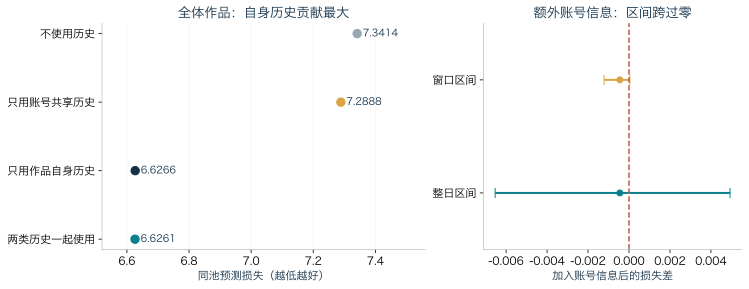
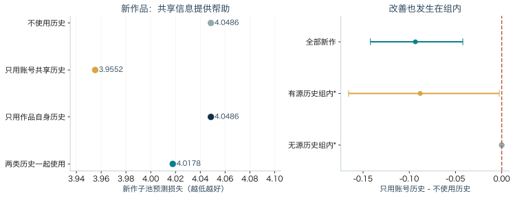

# 旧作品、账号信息与新生产：内容平台的曝光实验与创作者博弈

**摘要**　生成式 AI 降低了内容制作成本，账号又可以低成本增设，平台因此担心“按账号压缩曝光回报”会推动创作者转向多账号。这是本文的背景，不是已经检验的结论。现有材料没有 AI 采用与成本变化、经济主体的多账号映射和排序规则冲击，无法直接回答这个因果政策问题。本文实际完成两项工作：在 KuaiRec 的 343,341 个作品日上，用同一候选池、同一信息截止和四个嵌套评分族，比较目标作品自身记忆与同账号共享信息对未来曝光的预测价值；并在给定平台规则下，建立含旧作库存与账号状态的两期创作者博弈，用逆推求解生产与开号选择。结果显示，作品自身记忆的增益远大于账号共享信息；控制作品记忆后，后者的总体增量仅约 −0.00045，且集中、区间跨零；没有自身历史的新作品上，共享信息有有限价值，但不足以证明不可转移资本。理论部分说明旧作足够多时零新生产可以是均衡，前瞻生产不同于逐期短视；开号只是凹规则、成本与状态共同作用的条件结果。本文不估计 AI 成本冲击、真实多账号或平台最优规则。

**关键词**：曝光预测；作品记忆；账号共享信息；创作者博弈；旧作品存量

## 1 研究问题、背景与实际贡献

生成式 AI 降低创作成本，是本文的现实背景。制作一条内容的边际成本下降，注意力的总量却没有同步增加；如果平台按账号限制可获得的曝光，创作者就可能把内容分散到多个账号。这个担忧有三个前提：平台的数量回报是凹的，旧作品会继续获得曝光，开新号成本足够低。三者都需要经验支持，但本项目的数据没有直接观测它们。

因此，本文没有把“AI 降本导致拆号”当作已知事实，而是先回答一个更基础的问题：未来曝光究竟能从哪些历史信息中预测出来？如果历史预测力主要来自目标作品自己的过去，那么把旧作流量解释成“账号资本”或“新生产回报”就多走了一步；如果同账号其他作品的信息在控制作品记忆后仍有增量，才值得把账号状态单独写进模型。这个问题对应本文的第一个研究问题：

> **问题一（预测）**：在真实短窗口曝光记录中，目标作品自身的过去曝光、同账号其他作品的共享信息，各自能为未来曝光提供多少增量？当目标作品没有自身历史时，答案是否改变？

预测结果又反过来决定理论模型该带什么状态。本文的第二个问题是：

> **问题二（理论）**：如果旧作品仍可被推荐、账号状态会随曝光积累，给定平台规则，两位创作者的本期生产与开号选择会怎样改变？什么条件下“不生产、靠旧作”会成为均衡的一部分？

两个问题的证据标准不同。问题一用真实历史记录做预测检验，结论限于样本、候选池和任务；问题二给定参数和规则求解模型，结论限于情景，不是对现实行为的估计。两者并列，是因为它们共同回答“旧作品、账号信息与新生产如何区分”。

本文解决了三件事。第一，在包含新作、但以旧作为主的全样本上，把“作品自己的过去”和“同账号共享信息”分开评分，发现仅作品族的增益约为 −0.715，共享信息在控制作品记忆之后的总体增量只有约 −0.00045，且三种区间都跨零。第二，在新作品切片上找到有限的正面结果：没有自身历史时，仅账号共享信息相对无状态改善约 −0.093，有源历史组内改善约 −0.088；但这只是共享关联，不是资本因果效应。第三，把旧作仍可推荐、账号状态可积累写进一个两期博弈，推出旧作足够多时零新生产可以是均衡，并说明前瞻解与逐期短视可以明显不同。本文没有解决 AI 采用、经济主体多账号、排序规则冲击、平台最优政策、质量、收入或福利等问题。

这是课程项目意义上的应用建模与初步分析：把“旧作品仍可推荐”和“账号状态可积累”从一句直觉拆成可计算的状态、评分与转移；用一个共享候选池、共同信息截止的预测比较区分两种历史信息来源；并说明哪些预测结论成立、哪些机制解释不能成立。模型沿用内容创作竞赛（Yao 等，2024）与账号成本设定，并借用存量—流量视角，不主张新的基础博弈理论或出版优先权。

## 2 概念、术语与一个贯穿例子

### 2.1 先分清五组对象

第一组是曝光、独立观众和点赞。曝光是一个作品在某一天被记录的展示次数；同一个观众可能贡献多次曝光，所以曝光不是去重人数。点赞是互动行为，既不是曝光，也不等于质量。本文只把曝光计数作为预测目标，没有使用点赞。

第二组是份额和总量。份额是同一候选池内某作品或账号的曝光占池内总曝光的比例；总量是计数。份额的分母是“当天实际进入候选池的作品”，不是全平台。评价时还会用实际曝光数给每个作品日加权；这个权重是计数，不是独立样本量。

第三组是作品、账号和经济主体。作品是内容单位；账号是平台上的作者标识；经济主体是真正控制一组账号的人或组织。数据只有账号标识，没有经济主体映射；不同账号不一定是不同人，同一账号也不一定是同一人。

第四组是旧作品、新作品和新账号。旧作品是上传日之后仍被记录的作品；新作品是源表中日期等于上传日的作品，首日是上传自然日，不是完整 24 小时；新账号是注册意义上的新号，本项目没有观测，只有“训练窗未见账号”。新作品不是新账号，未见账号也不是新注册。

第五组是预测与理论对象。作品记忆 m 是目标作品过去曝光相对年龄/时长基准、并在样本少时向 1 拉近的残差比；理论库存 B 是仍可参与推荐的旧作品有效存量。账号共享信息 h 是同账号不相交来源作品的同类残差比；账号资本 H 是模型假设的、附着于账号的积累；创作者能力 θ 是可能跟人走的持续能力。m/h 是预测指标，B/H/θ 是模型状态和参数。预测关联是用截止 t 前的信息预测 t 后的曝光；因果效应需要外部给定的变化，例如随机曝光或规则变化。真实离线预测用历史做预测评分；数值情景给定参数求解模型。两者不能互相冒充。

### 2.2 术语表

表 1 只放正文反复使用的测量与实验术语；表 2 放博弈符号。

| 术语 | 本文定义 | 不要混成 |
|---|---|---|
| 曝光 | 某作品某日被记录的展示次数；KuaiRec 用 `show_cnt`，外部源用 `impressions` | 独立观众、点赞、质量、收入 |
| 独立观众与点赞 | 独立观众是去重人数；点赞是互动计数 | 曝光；点赞不是质量 |
| 曝光份额与曝光总量 | 份额是同一候选池内该作品/账号曝光占池内总曝光比例；条件份额是在指定子池内重新归一化后的份额；总量是计数 | 全平台份额、点击率；总量不是人数 |
| 曝光权重 | 评分时按实际曝光数加权；总权重是计数之和 | 独立样本量 |
| 候选池 | 某日源表实际有记录的作品集合 | 全平台可推荐库存 |
| 作品、账号、经济主体 | 作品是内容单位；账号是作者标识；经济主体是真正控制账号的人或组织 | 账号不等于真人/团队；作者标识不是经济主体 |
| 旧作品、新作品、新账号 | 旧作是上传后仍被记录；新作是日期等于上传日的上传自然日；新账号是注册意义上的新号 | 新作不是新账号；未见账号不是新注册 |
| 作品记忆 m | 目标作品过去曝光/年龄时长基准期望的残差比；样本少时把估计值拉向 1 | 理论库存 B、质量、因果反馈 |
| 账号共享信息 h | 同账号不相交源作品的同类残差比，同样在样本少时拉向 1；同日同账号目标作品共用 | 资本 H、经济主体能力 |
| 基准 e | 训练期按年龄/时长分组的期望曝光；μ 是全局均值 | 质量、需求 |
| 交叉熵 | 曝光加权的负对数预测份额；模型给实际曝光作品的份额越低，惩罚越大。单位奈特（nats，信息量单位），越低越好 | 效用、福利、因果效应 |
| 联合损失与条件损失 | 联合把分给子池之外作品的概率也计入；条件只在指定子池内重新归一化。两者回答不同问题 | 两个可互换指标 |
| 预测关联与因果效应 | 预测关联用截止 t 前信息预测 t 后曝光；因果效应需外部给定的变化 | 预测增益不是因果效应 |
| 真实离线预测实验与数值情景 | 前者用真实历史做留出预测（留出一段数据不参与选参数，只用于最后评分）；后者给定参数求解模型 | 模型情景不是现实行为 |

| 符号 | 含义 | 不要混成 |
|---|---|---|
| B | 仍可参与推荐的旧作品有效存量，按标准化内容单位计 | 原始视频件数、过去曝光、观测到的作品总数 |
| H | 附着于账号、可能随曝光积累的状态；本文作为假设 | h、粉丝数、已证资本 |
| θ | 可能随创作者转移的持续能力或题材匹配 | 账号资本 H |
| x | 本期新生产 | 观测到的作品总数、近期上传数 |
| 评分 S 与 α | S=θw(H)(B+x)^α；w(H)=(1+H)^b；α 是评分对内容量的弹性，1 为线性、小于 1 为边际递减 | 平台真实规则、预测指数 |
| p 与 R | p 是曝光份额；R 是把全部曝光折算成收益的总盘子 | 现金收入、点击率、观看者福利 |
| c、F、μ | c 为单位生产成本；F 为一次性开户费；μ 为每期额外账号维护费 | 平台审核成本、贴现 |
| ρ_B、δ_H、λ_H | B'=ρ_B B+x；H'=δ_H H+λ_H p | 预测平滑、经验记忆 |
| χ | 贴现因子，明天一元今天值多少 | 折旧率 |
| 前瞻、短视与子博弈精炼均衡 | 前瞻把今天行动对未来状态和对手反应计入；短视只优化当期；子博弈精炼要求每个子博弈都取最优 | 单期同时行动均衡、平台最优 |

### 2.3 一个贯穿例子（解释性假设数据）

设账号 a 有两类作品：来源组 S_a 是两部旧作，只用于构造共享信息；目标组是明天候选池中的 A、B 和新作 C。账号 b 同理，来源组 S_b 构造 h_b，目标是 D。S_a 与 {A,B,C} 不相交，S_b 与 {D} 不相交。现实中的 A/B 是两个作品组，每组可以有很多作品；这里只列四部作品。

假定已经过 7 日半衰期和 7 个作品日先验调整后，目标作品的基准与记忆如下；m 是平滑后的权重，不是把某天曝光直接除以当天基准。

| 目标作品 | 账号 | 基准 e | 过去曝光 | 记忆 m（假定平滑后） |
|---|---|---:|---:|---:|
| A | a | 400 | 800 | 2.0 |
| B | a | 200 | 100 | 0.5 |
| C | a | 200 | 无 | 1.0（先验） |
| D | b | 300 | 300 | 1.0 |

先只用作品记忆。取 α=1、γ=1，分数 z=e×m：A 为 800，B 为 100，C 为 200，D 为 300，总和 1,400；份额分别为 57.1%、7.1%、14.3%、21.4%。如果当天总曝光是 1,400，预测曝光就是 800、100、200、300；实际评价不会把当天总曝光当输入，这里乘 1,400 只是把份额翻译成直观数字。

再加入共享信息。设从 S_a 估出 h_a=1.5，从 S_b 估出 h_b=1.0，取 β=1。共享项对同一账号的所有目标作品是公共的：A 变为 1,200，B 为 150，C 为 300，D 为 300，总和 1,950；份额变为 61.5%、7.7%、15.4%、15.4%。账号 a 的总份额上升，D 的份额下降；但在账号 a 内部，A:B:C 仍是 800:100:200，也就是 1,200:150:300，相对份额完全不变。这就是为什么在单频道日份额里，公共 h 会约掉：它改变账号之间的分配，不改变同一账号内部作品之间的分配。

新作品 C 的特殊之处在于 m_C=1，它没有自己的过去，只能利用账号 a 的共享信息。h_a 高时 C 的份额从 14.3% 升到 15.4%，h_a 低时 C 会被压低；但 h_a 不能告诉我们在账号 a 内部 C 是否比 A/B 更好，那需要 C 自己的历史，而新作没有。若把 C 搬到新账号，h_a 是否跟随没有任何观测；模型里的新账号 B=H=0 是制度假设，不是“换号就丢资本”的经验事实。

把这条链画成文字流程：

```
截止 t 的记录
  ├─ 目标作品自身过去 → m → z=(e/μ)m^γ
  └─ 同账号不相交来源组 → h
z 汇总为账号总权重 T_a → 分数 s=h^β T_a^(α−1)z
→ 当日候选池归一化 → 份额 p → 预测曝光
```

## 3 数据与实验设计

### 3.1 数据与候选池

主数据是公开的 KuaiRec 短视频曝光记录（Gao 等，2022），覆盖 2020-07-05 至 09-05，共 343,341 个作品日、10,728 部作品、8,369 个账号。一个“作品日”是一部作品（`video_id`）在某天的一条记录，账号标识是 `author_id`；`show_cnt` 是当天曝光。缺失日不补零：只有当天源表里实际有记录的作品才进入候选池，没有记录不等于真实零曝光。因此候选池是“条件于来源观察池”的集合，不是全平台可推荐库存。

外部补充是 OpenChannelStats 上频道主自愿公开的逐日曝光。公开清单有 7 个入口，6 个非空，4 个达到预定覆盖门槛；测试期共有 960 个视频日、7,824 次曝光。它是第三方公开记录，不是 YouTube 官方随机样本，只用于有限复制，不与 KuaiRec 混成同一张表。

### 3.2 时间切分与信息截止

按作品标识做固定分组，把作品分成 A/B 两组；A 组的历史用于构造账号共享信息、预测 B 组，再反向一次。目标作品的 m 只用目标作品自己在 t 前的记录；h 只用同账号、与目标作品不相交的来源组。两方向复用同一批数据，不是独立复制；目标作品互斥。

每个方向有四个起点；训练窗在前用于拟合，校准窗居中用于选参数，测试窗在后只用于评分，分别为 14、7、7 天。t 日的特征只读取 t 之前的记录；先评分，再观察 t 日曝光，然后把它并入 t+1 日的状态。测试期逐日更新只用已经发生的前一日反馈，预测时属于过去，不是泄露未来。参数只在 7 天校准期选择，测试期只评分。四个起点的测试窗有重叠，合并后有 28 个不同测试日。

### 3.3 四个嵌套评分族

四个评分族共用同一年龄/时长基准、同一候选池和同一参数网格：

- 无状态：只用年龄/时长基准；
- 仅作品：加入目标作品自己的记忆 m；
- 仅账号：加入同账号共享信息 h；
- 双状态：同时加入 m 和 h。

评分写成 `z_v=(e_v/μ)m_v^γ`，`T_a=Σ z_v`，`s_v=h_a^β T_a^(α−1) z_v`；同账号汇总为 `Σ s_v=h_a^β T_a^α`。其中 γ 是作品记忆的幂次，β 是共享信息的幂次，α 是账号总权重的幂次。α 在 {0.5,0.75,1} 中选，γ 和 β 在 {0,0.5,1} 中选；无状态、仅作品、仅账号、双状态分别有 3、9、9、27 个设置。四个族都用 T_a 汇总同账号目标作品权重，所以“仅作品”不是单独把 m 放进一个线性公式，而是项目定义的一个评分族；主比较中两族的 T 算法相同，新增的只有 h。这个评分式只是预测形式与理论形式的对应，不表示库存或资本转移已被估计。

候选池是当天源表实际有记录的目标作品；份额的分母是这个池的总曝光。评分时每个作品日按实际曝光数加权，总权重 14,009,144,990 是计数之和，不是 140 亿个独立样本。测试规模为每个模型 190,568 个作品日、8,107 个观察账号，其中 19 个零总曝光账号保留。

### 3.4 校准与区间

四个族都在校准期选参数，测试期不再改。95% 区间有三种重复抽样：按整日配对、以整个测试窗为块、固定预测按账号整块。它们都不重拟合，衡量的是固定预测下的抽样敏感性，不是因果置信区间，也不覆盖观看者与时间之间的全部依赖。

### 3.5 这套设计能回答与不能回答什么

这套设计能回答的是：在截止 t 前可用的信息中，哪一种历史来源对 t 后曝光有预测增益。它不能回答：如果平台改变规则、给某个作品更多曝光，会发生什么。数据没有经济主体映射、注册时点、迁移记录、AI 采用或成本变化，也没有排序规则冲击；因此不能把 h 直接叫不可转移资本，不能把预测选出的 α=1 叫平台线性，不能把新作品叫新账号，也不能把旧作品持续曝光叫状态转移已被验证。缺失日不是零曝光，候选池也不是全平台。这些边界是研究设计的一部分，后文只在具体结果处点明含义，不再逐段重复。

## 4 主要实验结果

### 4.1 全体作品：作品记忆是主，账号信息是次

这一小节回答：目标作品自己的过去是否有预测信息，控制它之后同账号共享信息还有多少增量。输入是上述 343,341 个作品日；预测目标是同一候选池内下一段测试期的曝光分配；对照是四个评分族；评分是曝光加权的视频联合交叉熵，越低越好。四族在同一候选池、基准和校准规则下比较，测试期只评分。

| 评分族 | 视频联合交叉熵 | 相对无状态 | 相对仅作品 |
|---|---:|---:|---:|
| 无状态 | 7.341395 | — | — |
| 仅作品 | 6.626575 | −0.714820 | — |
| 仅账号 | 7.288813 | −0.052582 | +0.662238 |
| 双状态 | 6.626127 | −0.715268 | −0.000448 |

结果有三层。第一，目标作品自己的过去很有信息：仅作品族相对无状态改善 −0.7148，日期区间 [−0.7839,−0.6499]，不含零。第二，仅账号相对无状态也有 −0.0526 的改善，区间 [−0.0651,−0.0402]，说明账号信息并非完全无用；但它远小于仅作品族的增益，单独使用仍远差于仅作品。第三，控制作品记忆后，双状态相对仅作品的总体增量只有 −0.0004484，日期区间 [−0.0065349,+0.0049345]、起点区间 [−0.0012171,+0.0000432]、账号区间 [−0.0189637,+0.0157660]，三种区间都跨零。与 −0.7148 相比，这个数在量级上小约三个数量级；但两者不是同一个比较，不能据此做百分比归因。

这里的 190,568 个测试作品日包含 4,315 部新作品，不是“只含旧作品”的样本；旧作品占多数是样本构成，不是筛选条件。

{width=100%}

图 1 左图是四个评分族在同一候选池上的预测损失，横轴越低越好；右图是“加入账号信息后的损失差”，即双状态减仅作品。图中两条横线分别是整日配对区间和起点窗口区间，正文还报告账号聚类区间；三种区间都跨零，表示这个平均增量在重复抽样下不稳定。区间均为固定预测下的重复抽样，不是因果置信区间。图源：本项目预测评估汇总。

### 4.2 平均增量很小，而且集中

8,107 个观察账号中，152 个账号的主差值改善，7,822 个变差，133 个为零。固定预测、不重拟合、不重新归一化，移除曝光最高 1、5、10 个账号的评分贡献后，差值变为 +0.004643、+0.010586、+0.014307，符号反转。这是评分贡献诊断，不是移除大账号后的市场反事实，也不能说明账号信息只由一个大账号产生。

可用于构造 h 的账号来源历史只覆盖 26.04% 的测试作品日、41.42% 的曝光；其余目标作品的 h 回退到先验 1，双状态在这些作品上只剩作品记忆，因而与仅作品接近。这解释了总体平均为何被大量无源历史作品稀释，但不能用有源切片替代预先规定的总体比较。结论是：总体增量很小、集中、不稳健；不能说存在普遍的账号资本，也不能说账号信息完全无用，下一小节的新作品就是反例。

### 4.3 新作品：有限的正面结果，但不是双状态最好

这一小节回答：当目标作品没有自身历史时，同账号共享信息是否有用。输入是 4,315 部在源表中有上传自然日记录的新作品；m 固定为 1；h 来自同账号不相交的来源作品；目标作品当天反馈不进入特征。预测目标是新作品子池内的条件份额，同时报告全候选池的联合损失。对照仍是四个族；评分是条件交叉熵和联合交叉熵。条件损失只在新作品子池内重新归一化，联合损失保留分给旧作品等其他作品的概率；两者回答不同问题。

| 新作品指标 | 无状态 | 仅作品 | 仅账号 | 双状态 |
|---|---:|---:|---:|---:|
| 全候选池内新作品联合损失 | 6.218071 | 6.240014 | 6.130154 | 6.241418 |
| 新作品子池条件损失 | 4.048581 | 4.048581 | 3.955176 | 4.017787 |

先看条件损失。仅账号相对无状态改善 −0.0934049，日期区间 [−0.1420583,−0.0420770]，起点区间 [−0.1164247,−0.0579637]，不含零。仅账号的 3.9552 是四个族中最好的；双状态 4.0178 反而比仅账号差，双状态减仅账号为 +0.0626113，日期区间 [0.0240371,0.1016149]，变差。复杂模型不是新作品的最佳模型。

再看联合损失。双状态减仅作品为 +0.0014035，日期区间 [−0.0281169,+0.0395836]，是变差；条件口径下双状态减仅作品为 −0.0307936，但日期区间 [−0.0627968,+0.0060534] 跨零，起点区间 [−0.0512752,−0.0094173] 不含零。两个指标、两种时间区间给出不同结论，不能只挑有利的一个。仅作品在新作品联合损失上甚至比无状态差，这与新作品没有自身历史、而账号总权重仍汇总同账号旧作品有关；具体机制没有单独拆解。

关键的分组诊断是结果后固定预测诊断，不重拟合。710 部有不相交源历史的新作品，组内条件损失从 2.526059 降到 2.437922，差 −0.0881376，日期区间 [−0.1657274,−0.0026242]；3,605 部无源历史的新作品，h 回共同先验，组内差约为 0。评分恒等式为 −0.0934049 = 组间 −0.0494430 + 曝光加权组内 −0.0439620；这是评分分解，不是资本因果贡献比例。正面结果不全是组间校正，有源组内部也有改善；但仍是共享关联，不能区分 θ 与 H。

在 3,747 个有新作曝光的账号中，1,116 个改善、2,631 个变差；固定评分移除前 1、5、10 个账号的贡献后，差仍为 −0.0789、−0.0481、−0.0400，说明改善不是单一账号驱动，但这些是预测误差，不是作者福利。还必须区分两个分组：710/3,605 是“是否有不相交源作品构造 h”，−0.0881 对应 710 组；795/3,520 是“训练窗是否见过该账号”，描述覆盖，不是注册年龄。795 不是新账号，710 也不是新账号。把 710 写成 795，或把“源历史可用”写成“新注册”，都会讲错。

{width=100%}

图 2 左图是新作品子池的条件损失，横轴越低越好；右图是“仅账号减无状态”的差值，全部新作品与有源历史组内两条区间都在零左侧，无源历史组内几乎为零。带星号的组内结果是结果后固定预测诊断，不是独立确认；有源组内区间的上界接近零，说明正面结果有限。区间为固定预测下的重复抽样，不是因果置信区间。图源：同前。

### 4.4 两个负面结果：α 全选 1，一步预测不胜前日

四个评分族在 8 个校准单元中共有 32 次 α 选择，候选为 {0.5,0.75,1}，32 次全部选 1。这是重要的负结果：在当前有限参数范围、当前候选池和当前评分族中，校准没有选择凹数量形式。它不表示平台真实 α=1，也不表示凹规则不可能起作用；它只说明本轮数据没有支持“现实推荐按凹数量奖励”这个初始前提。把预测参数当成平台因果弹性，是把模型调参误读成制度估计。

另一个负结果来自一步预测。只用相邻两个自然日都有记录的作品对和账号对，预测下一日曝光的对数（先对曝光加一，再取对数）；对照是前日延续、一阶自回归（AR(1)，用前一天值预测今天）、以及一阶自回归再加入观测到的作品记忆、账号信息与过去可见的作品总数和近期上传数。作品有 182,363 对，均方误差（预测误差平方的平均）为 0.7831、0.8543、0.9415；账号有 138,286 对，为 0.8941、0.9737、1.0169；四个窗口都是前日延续最好。加入更多状态变量没有改善下一日曝光的预测。这不等于 B/H 不存在，也不等于长期动态不重要；它只说明用这些观测状态做一步预测没有胜过简单延续，因此不能用 m/h 的定义恒等式冒充模型里的状态转移已被验证。

### 4.5 外部小源：复制了作品记忆，但没有复制账号资本

这一小节回答：作品记忆是否只是 KuaiRec 候选池的假象。输入是 4 个合格频道的 960 个测试视频日、7,824 次曝光，测试窗为 2026-10-27 至 11-02；预测目标是频道内当日份额；对照是年龄基准、年龄×记忆（年龄基准乘作品记忆）、前日加先验（前日有记录就用前日曝光加一，否则回年龄基准）；评分是频道内条件交叉熵。每个频道独立划分 14/7/7 日，缺失不补零，合并只汇总评分，不假设频道共享市场。

| 频道 | 测试视频日/曝光 | 年龄 | 年龄×记忆 | 前日+先验 |
|---|---:|---:|---:|---:|
| theartharrison | 345 / 1,118 | 3.404981 | 3.395492 | 3.368395 |
| a-dventures-and-travels | 343 / 546 | 3.415888 | 3.359222 | 3.557104 |
| breakwayyt | 223 / 399 | 3.449662 | 1.866707 | 1.586184 |
| koura_yt_mfun | 49 / 5,761 | 1.938872 | 1.363332 | 1.232990 |
| 合并 | 960 / 7,824 | 2.328489 | 1.818669 | 1.718326 |

年龄×记忆相对年龄改善 −0.509820，日期区间 [−0.569385,−0.440325]；四个频道的点估计方向都改善，固定评分去掉 koura 后仍为 −0.326295。但更简单的前日加先验为 1.718326，比年龄×记忆的 1.818669 更好；koura 一个频道占 73.63% 的权重。这是有限外部一致性，不是平台普遍规律。

更重要的是，这个外部源不能复制账号资本或 α。频道内日份额里，同一频道所有作品共用的 h^β 和 T^(α−1) 会在归一化中约掉；没有多账号共享状态，也没有共同完整市场预算。它能说明“目标作品自己的过去在另一个来源也有预测价值”，不能说明“账号资本被复制”。

## 5 给定平台规则下的创作者博弈

### 5.1 模型对象、时序与符号

理论部分回答：如果旧作品仍可推荐、账号状态会积累，给定平台规则，两位创作者会怎样选择本期生产和开号。平台先承诺推荐规则，两位创作者同时行动；平台不是本文求解的战略玩家，观众也不是。每位创作者已有旧账号，可选择本期生产 x、是否开新号、如何在账号间分配内容。旧作品仍参与推荐；已有账号可以零生产；新号首期至少生产一件。收益是曝光带来的效用减去生产成本，再减去开户与维护成本；两期收益按贴现因子相加。这里的效用按曝光份额折算，不是观看者福利，也不是现金收入。

表 2 已给出符号。单账号的核心式是：

`S_i=θ_i w(H_i)(B_i+x_i)^α`，`w(H)=(1+H)^b`，`b≥0`；

`p_i=S_i/(S_i+S_j)`，`u_i=R p_i−c x_i`；

`B_i'=ρ_B B_i+x_i`，`H_i'=δ_H H_i+λ_H p_i`。

多账号时，总评分和总份额分别是各账号之和；开号还要付一次性 F 和每期 μ。新号 B=H=0，w(0)=1；b=0 是“账号状态不影响评分”的模型内对照。评分 S 不是收益，p 不是现金收入，B/H 不是本期生产。把 S 当收益会把曝光当收入；把 B 当本期生产会把旧作流量当新作回报；把 H 当已证实资本会把假设当估计。这三件事必须分开。

平台规则、成本、保留率和反馈系数都是情景参数，不是从曝光数据估计的。数据能告诉我们哪种预测指标值得写进模型，不能告诉我们真实的 B/H 转移率、开户费或平台 α。这条存量—流量思路与 Sun 和 Sun（2026）的创作者粉丝存量研究相邻，但本文的 B/H 是情景状态，不是用其数据估计出来的。

### 5.2 一期切片：旧作足够多时，零新生产可以是均衡

先看固定状态、单个账号、对称内点（双方都生产正数量）的切片。两位创作者条件相同，均衡份额 p=1/2；对本期生产求一阶条件（边际收益等于边际成本）：

`c=R p(1−p) α/(B+x)`。

代入 p=1/2，得到 `B+x=Rα/(4c)`，所以

`n*=max(0, Rα/(4c)−B)`。

这个式子只说明一个切片：旧作存量 B 越大，本期最优新生产越小；当 B 足够大时，n*=0，创作者依靠旧作仍能获得曝光，零新生产成为角点（边界解）。它把“旧作流量不是新生产回报”写成了模型语言，但它不是一般均衡定理；多账号、约束、动态反馈都会改变这个切片。这个结论也不需要把平台设成第三个战略玩家。

### 5.3 两期：逆推为什么会让今天的选择不同

两期求解不是重复两次一期最优。先解第二期：对每一个第一期行动后可能到达的状态，求出第二期的均衡行动和收益；这就是第一期的继续价值。再回到第一期，每位创作者选择使“当期收益 + χ×继续价值”最大的行动，并检查单边偏离（固定对手策略，只看自己单独改变行动是否更赚）。今天多生产会提高明天的 B，今天多曝光会提高明天的 H，对手明天也会重新行动。因此，今天的选择不能只看当期边际。

一个已核验的解析例可以说明差别。取 R=12、c=1、α=1、B_1=2.5、H_1=0、ρ_B=0.25、χ=0.25、w(H)=1+H、δ_H=0.8、λ_H=1，并把开户成本设得足够高以排除开户，只比较前瞻与短视。只看当期时，本期生产为 0.5；把两期状态和对手反应计入后，本期生产约为 1.8333，两期贴现净收益为 5.53125。这个例子是假设参数下的模型演示，不是实证估计，也不是“前瞻一定多生产”的普遍定理；换参数、换约束，方向可能改变。完整路径与偏离检查留在项目归档的推导中。

有限数值情景给出同样的提醒。48 个主情景在三种成本条件（基线、双方成本减半、仅第一位成本减半）下比较；其中 34 个的前瞻首期行动不同于短视，6 个情景的首期均衡出现开号，全部在 α=0.5 且成本下降的条件下，终期没有继续开号。另做 24 个 α=1 的线性补充情景，是看到结果后追加的诊断，不替换主情景组：24 个情景的前瞻首期行动都不同于短视，所选路径没有开号。6 不是现实中的开号频率，24 个线性情景的 0 也不是“线性规则永不拆号”的定理。

| 情景族 | 规则 | 前瞻首期不同于短视 | 首期开号 | 终期开号 |
|---|---|---:|---:|---:|
| 48 个主情景 | α∈{0.5,0.8}，含成本变化 | 34 / 48 | 6（全在 α=0.5） | 0 |
| 24 个线性补充 | α=1，结果后追加 | 24 / 24 | 0 | 0 |

### 5.4 开号：一个短政策情景，不是全文结论

若平台对账号总量给凹回报（α<1），旧账号已经积累了很多 B，新增内容在旧账号上的边际评分（新增一单位内容带来的评分增量）会下降；新号从零开始，边际评分较高，所以把一部分生产放到新号可能提高总评分。但新号没有 B/H，还要付 F 和 μ，因此是否开号取决于凹的程度、成本、旧库存和对手行为。反之，在旧号权重不低于新号的线性切片里，把内容放在旧号不劣，开户与维护成本使开号无利；24 个线性补充情景确实没有开号，但这只是有限情景。

数据方面的负结果正好卡住这个前提：32 次校准都选 α=1，当前候选范围没有支持凹数量形式。因此，凹规则下的拆号只能作为待检验的政策情景，不能写成现实制度，也不能写成“AI 降本必然开号”。本文没有估计平台目标、福利或最优政策；平台规则在博弈之外给定，这不是一个把平台、创作者和观众一起求解的三方博弈。

## 6 讨论、局限与最终回答

### 6.1 两条证据链合起来说什么

预测链的结论是：作品自己的过去最稳健；同账号共享信息在控制它之后，对全体作品的总体增量很小、集中、区间跨零；新作品上没有自身历史时，共享信息有有限价值，但有源组内改善仍是关联，不能升级为不可转移资本。外部小源复制了作品记忆方向，却没有复制账号资本，且简单前日基准更好。

理论链的结论是：旧作品存量使“本期不生产、靠旧作”成为可能的边界解；两期逆推使今天的选择不同于逐期短视；开号是凹规则、成本和状态共同作用的条件结果。两条链不能互相冒充：预测增益不证明模型里的状态转移，模型情景不证明现实行为。合起来能回答的是“该把什么状态写进模型、行为会怎样变”，不是“AI 是否已经导致拆号”。

对最初的多账号问题，三个前提的状态不同：凹规则没有被当前预测参数范围支持；旧作品持续曝光与数据相容，但 B/H 转移没有被验证；低成本开号没有被观测。因此，初始问题没有被证明为假，而是被降级为一个条件性问题。这个降级本身也是结论一环。

### 6.2 局限

数据方面，候选池条件于源表观察，缺失不补零，窗口只有 7 天测试，两个方向复用同一批数据；外部样本只有 4 个频道、960 个视频日，且一个频道占 73.63% 权重。模型只有两期、有限动作、给定参数，没有估计真实成本、开户费、状态转移或平台规则；没有质量、收入、观看者福利，也没有经济主体映射、AI 采用或排序规则冲击。要推进因果问题，需要经济主体关联的长期记录、外部成本或规则变化、真实新账号的注册与迁移记录，以及更长的观察。

### 6.3 最终回答

| 问题 | 直接回答 |
|---|---|
| 研究了什么 | 未来曝光的历史信息来源；给定平台规则下含旧作库存与账号状态的两期生产博弈 |
| 实际解决了什么 | 区分作品记忆与账号共享信息在全体作品和新作品上的预测价值；把旧作流量与新生产回报分开；建立并求解两期博弈 |
| 有效结果是什么 | 作品记忆损失差 −0.7148；控制后总体增量 −0.00045，集中且区间跨零；新作品仅账号 −0.0934，有源组内 −0.0881；外部 −0.5098 但前日基准更好；32 次 α 全选 1；48 个主情景中 34 个前瞻改变、6 个首期开号，24 个线性补充 0 开号 |
| 哪些仍未解决 | AI 采用与成本、真实经济主体多账号、排序规则冲击、h 是否为 H、平台最优政策、质量/收入/观看者福利 |

一句话总结：本文没有证明 AI 导致拆号；它做的是把旧作品、账号信息与新生产分开，并说明在现有证据下哪些主张成立、哪些必须等待更好的数据。

## 参考资料

1. Gao, C., Li, S., Lei, W., Chen, J., Li, B., Jiang, P., He, X., Mao, J., Chua, T.-S. KuaiRec: A Fully-observed Dataset and Insights for Evaluating Recommender Systems. CIKM 2022. arXiv:2202.10842. 官方代码与数据：https://github.com/chongminggao/KuaiRec
2. OpenChannelStats. Public channel data and manifest. https://openchannelstats.com/data；https://openchannelstats.com/channels-manifest.json（2026-11-05 访问）。
3. Yao, F., Li, C., Nekipelov, D., Wang, H., Xu, H. Human vs. Generative AI in Content Creation Competition: Symbiosis or Conflict? Proceedings of ICML 2024, PMLR 235: 56885–56913. https://proceedings.mlr.press/v235/yao24b.html
4. Sun, Y., Sun, B. From exposure to followers: A stock-and-flow closed-loop framework of creator dynamics. Information Processing & Management 63(5), 104677 (2026). DOI: 10.1016/j.ipm.2026.104677.
