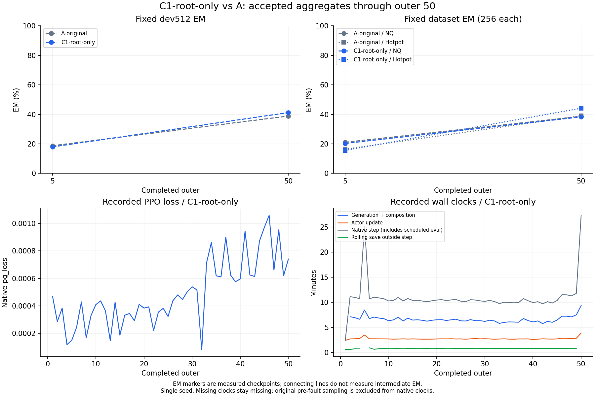

# C1与A：第5、50轮EM及C1原生loss、耗时

| 实验 | 第5轮EM | 第50轮EM | 第50轮NQ | 第50轮Hotpot |
| --- | --- | --- | --- | --- |
| 原A多代递归 | 96/512（18.7500%） | 199/512（38.8672%） | 99/256 | 100/256 |
| C1仅从根轨迹分叉 | 92/512（17.9688%） | 211/512（41.2109%） | 98/256 | 113/256 |

第50轮C1总体高2.34375个百分点，来自NQ汇总少1题、Hotpot多13题。这里没有逐题新增/丢失统计，也没有A重测。单seed、两个稀疏节点尚不能确定最终或跨seed优劣；图中连线不代表测量了中间EM。

C1记录的PPO pg_loss第1轮为0.000470851519，第50轮为0.000740901565，前50轮全部有限。PPO loss来自每轮变化的TRAIN cohort，且学习率仍按57轮warmup变化；它不是同一固定样本上的拟合曲线，不以单调下降作为性能结论。

右下图为既有原生wall clock。generation含生成和整理，native step含规定节点的保存与评测，rolling save在step之外；关键节点峰值不能解释为训练更新本身都变慢。缺失计时留空，C1首轮故障前生成不补入native时钟。累计token和完整成本限制见[同轮中文报告](../recursive-ablation-C1-outer050-20261015/findings-zh.md)。

本图只读取已发布的三个小汇总，输入原始字节来自报告commit `9b85e031f231f09d9597b649f25bfd765e8ce2b7`；绘图源码先发布为 `e6cea16956df2f8bc87ccea047f941756ba80fce`。输入/图文件SHA见[来源摘要](figure-provenance.json)，可导出[PDF](curves.pdf)。未增加训练、评测或原始轨迹读取，正跑源码未改。全部计划组各150轮尚未完成，继续规定的100/150节点及后续消融。
