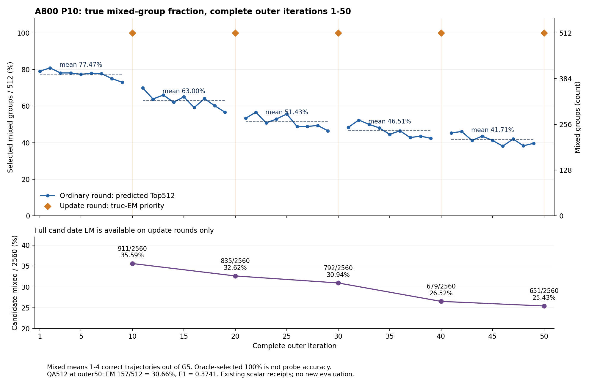

# A800 P10: QA50 and mixed groups across outer1-50 (2026-10-17)

This report projects existing native scalar receipts; it performs no new training or evaluation.

QA50 uses the same fixed512 question identities as QA5. EM157/512=30.6640625%, F1=.37414124503968255. QA5 EM118/512=23.046875%, F1=.2888516865079365; improvement39 correct /7.6171875 percentage points.

Mixed means 0<K<5 among the five strict-EM labels, including K=1. The main denominator is selected512 questions, not2560 trajectories.

| Ordinary outers | Mean mixed count /512 | Mean mixed % | Count range |
|---|---:|---:|---:|
| 1-9 | 396.67 | 77.4740% | 374-414 |
| 11-19 | 322.56 | 62.9991% | 290-358 |
| 21-29 | 263.33 | 51.4323% | 238-290 |
| 31-39 | 238.11 | 46.5061% | 217-268 |
| 41-49 | 213.56 | 41.7101% | 195-236 |

Update rounds10/20/30/40/50 all selected512 mixed groups with zero fallback, using realEM priority. This is not classifier accuracy.

| Update outer | Full candidate mixed /2560 | Candidate mixed % | Selected mixed /512 |
|---|---:|---:|---:|
| 10 | 911 | 35.5859% | 512 |
| 20 | 835 | 32.6172% | 512 |
| 30 | 792 | 30.9375% | 512 |
| 40 | 679 | 26.5234% | 512 |
| 50 | 651 | 25.4297% | 512 |

Probe50 mixed-group classification on its existing512-question diagnostic: ordinary accuracy44.140625%, balanced accuracy50.84892995%, all-nonmixed baseline378/512=73.828125%. These are not QA answer EM. The diagnostic uses newly sampled G5 events, so different update rounds do not share identical trajectory labels.

The ordinary selected fraction and full update-round candidate fraction both decline. This observation alone does not identify overfitting or a code defect.

## Every complete outer

| Outer | Selection | Mixed /512 | Mixed % | All correct | All wrong |
|---|---|---:|---:|---:|---:|
| 1 | predicted_Top512 | 405 | 79.1016% | 43 | 64 |
| 2 | predicted_Top512 | 414 | 80.8594% | 50 | 48 |
| 3 | predicted_Top512 | 400 | 78.1250% | 54 | 58 |
| 4 | predicted_Top512 | 400 | 78.1250% | 60 | 52 |
| 5 | predicted_Top512 | 396 | 77.3438% | 53 | 63 |
| 6 | predicted_Top512 | 399 | 77.9297% | 79 | 34 |
| 7 | predicted_Top512 | 398 | 77.7344% | 80 | 34 |
| 8 | predicted_Top512 | 384 | 75.0000% | 91 | 37 |
| 9 | predicted_Top512 | 374 | 73.0469% | 115 | 23 |
| 10 | true_EM_priority | 512 | 100.0000% | 0 | 0 |
| 11 | predicted_Top512 | 358 | 69.9219% | 110 | 44 |
| 12 | predicted_Top512 | 327 | 63.8672% | 124 | 61 |
| 13 | predicted_Top512 | 338 | 66.0156% | 122 | 52 |
| 14 | predicted_Top512 | 318 | 62.1094% | 132 | 62 |
| 15 | predicted_Top512 | 333 | 65.0391% | 136 | 43 |
| 16 | predicted_Top512 | 303 | 59.1797% | 152 | 57 |
| 17 | predicted_Top512 | 328 | 64.0625% | 139 | 45 |
| 18 | predicted_Top512 | 308 | 60.1562% | 150 | 54 |
| 19 | predicted_Top512 | 290 | 56.6406% | 168 | 54 |
| 20 | true_EM_priority | 512 | 100.0000% | 0 | 0 |
| 21 | predicted_Top512 | 273 | 53.3203% | 122 | 117 |
| 22 | predicted_Top512 | 290 | 56.6406% | 122 | 100 |
| 23 | predicted_Top512 | 260 | 50.7812% | 137 | 115 |
| 24 | predicted_Top512 | 271 | 52.9297% | 129 | 112 |
| 25 | predicted_Top512 | 285 | 55.6641% | 113 | 114 |
| 26 | predicted_Top512 | 250 | 48.8281% | 128 | 134 |
| 27 | predicted_Top512 | 250 | 48.8281% | 135 | 127 |
| 28 | predicted_Top512 | 253 | 49.4141% | 134 | 125 |
| 29 | predicted_Top512 | 238 | 46.4844% | 139 | 135 |
| 30 | true_EM_priority | 512 | 100.0000% | 0 | 0 |
| 31 | predicted_Top512 | 248 | 48.4375% | 163 | 101 |
| 32 | predicted_Top512 | 268 | 52.3438% | 168 | 76 |
| 33 | predicted_Top512 | 256 | 50.0000% | 158 | 98 |
| 34 | predicted_Top512 | 246 | 48.0469% | 176 | 90 |
| 35 | predicted_Top512 | 228 | 44.5312% | 197 | 87 |
| 36 | predicted_Top512 | 238 | 46.4844% | 183 | 91 |
| 37 | predicted_Top512 | 219 | 42.7734% | 189 | 104 |
| 38 | predicted_Top512 | 223 | 43.5547% | 198 | 91 |
| 39 | predicted_Top512 | 217 | 42.3828% | 213 | 82 |
| 40 | true_EM_priority | 512 | 100.0000% | 0 | 0 |
| 41 | predicted_Top512 | 232 | 45.3125% | 152 | 128 |
| 42 | predicted_Top512 | 236 | 46.0938% | 162 | 114 |
| 43 | predicted_Top512 | 211 | 41.2109% | 154 | 147 |
| 44 | predicted_Top512 | 223 | 43.5547% | 151 | 138 |
| 45 | predicted_Top512 | 211 | 41.2109% | 167 | 134 |
| 46 | predicted_Top512 | 195 | 38.0859% | 163 | 154 |
| 47 | predicted_Top512 | 215 | 41.9922% | 166 | 131 |
| 48 | predicted_Top512 | 196 | 38.2812% | 164 | 152 |
| 49 | predicted_Top512 | 203 | 39.6484% | 175 | 134 |
| 50 | true_EM_priority | 512 | 100.0000% | 0 | 0 |

Runtime source `0de9565c9b1c735635744f7e80a2526a2852e568`; run `387d3f6e228a488f90c418e2ba47e28e` / execution `1bf0183c24c84abfa8a65c587089145d`. Complete53 at capture; same pipeline continued54. Full scalar JSON and CSV preserve each joint SHA. No raw QA, token, rollout, weight, or credential is included.
