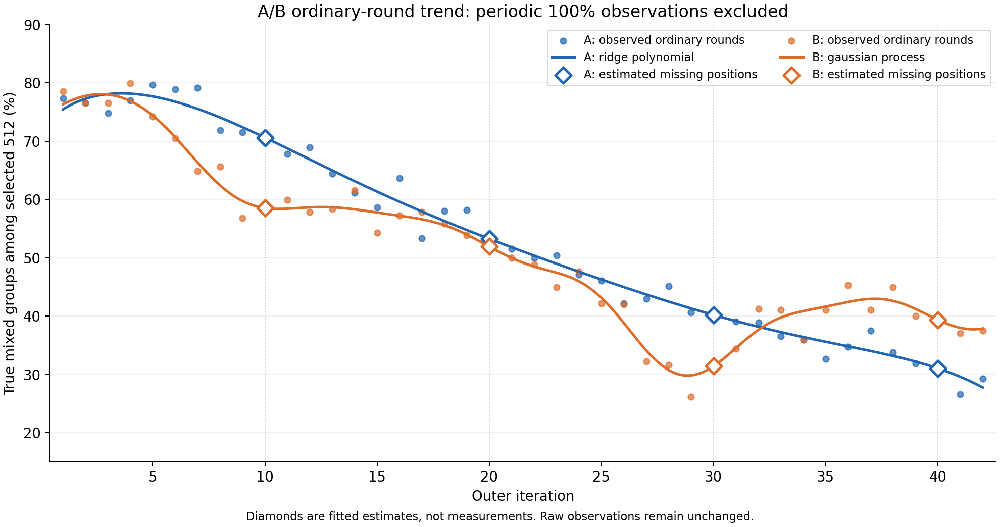

# A/B普通轮趋势拟合（截至第42轮）

原始数据不变。排除第10/20/30/40轮实际EM优先选题产生的100%后，各组使用38个普通轮实测值。下列四点是普通轮趋势估计，不是实测值，也不能证明周期轮改用普通选题会得到这些数值。

比较高斯过程、岭多项式、平滑样条和线性插值。对36个内部实测点逐点留一、每折重新拟合，按概率尺度RMSE选择参数和方法。该误差用于方法选择，不是独立泛化评测，也不是探针分类准确率。未外推第43轮以后。

| 方法 | A留一RMSE（百分点） | B留一RMSE（百分点） |
|---|---:|---:|
| linear_interpolation | 2.665 | 3.368 |
| ridge_polynomial | 2.490 | 4.001 |
| smoothing_spline | 2.527 | 3.162 |
| gaussian_process | 2.498 | 3.123 |

| 组 | 所选方法 | 参数 |
|---|---|---|
| A | ridge_polynomial | (6, 0.1) |
| B | gaussian_process | (0.15, 0.3) |

| 迭代 | A估计 | B估计 |
|---|---:|---:|
| 10 | 70.61% | 58.53% |
| 20 | 53.25% | 51.92% |
| 30 | 40.20% | 31.42% |
| 40 | 31.04% | 39.36% |

## 完整拟合版数据

普通轮保持实测值，只替换四个周期位置；‘估计’不代表实际混合题数。

| 迭代 | A | B | 类型 |
|---|---:|---:|---|
| 1 | 77.34% | 78.52% | 实测 |
| 2 | 76.56% | 76.56% | 实测 |
| 3 | 74.80% | 76.56% | 实测 |
| 4 | 76.95% | 79.88% | 实测 |
| 5 | 79.69% | 74.22% | 实测 |
| 6 | 78.91% | 70.51% | 实测 |
| 7 | 79.10% | 64.84% | 实测 |
| 8 | 71.88% | 65.62% | 实测 |
| 9 | 71.48% | 56.84% | 实测 |
| 10 | 70.61% | 58.53% | 估计 |
| 11 | 67.77% | 59.96% | 实测 |
| 12 | 68.95% | 57.81% | 实测 |
| 13 | 64.45% | 58.40% | 实测 |
| 14 | 61.13% | 61.52% | 实测 |
| 15 | 58.59% | 54.30% | 实测 |
| 16 | 63.67% | 57.23% | 实测 |
| 17 | 53.32% | 57.81% | 实测 |
| 18 | 58.01% | 55.86% | 实测 |
| 19 | 58.20% | 53.91% | 实测 |
| 20 | 53.25% | 51.92% | 估计 |
| 21 | 51.56% | 50.00% | 实测 |
| 22 | 50.00% | 48.83% | 实测 |
| 23 | 50.39% | 44.92% | 实测 |
| 24 | 47.07% | 47.66% | 实测 |
| 25 | 46.09% | 42.19% | 实测 |
| 26 | 42.19% | 41.99% | 实测 |
| 27 | 42.97% | 32.23% | 实测 |
| 28 | 45.12% | 31.64% | 实测 |
| 29 | 40.62% | 26.17% | 实测 |
| 30 | 40.20% | 31.42% | 估计 |
| 31 | 39.06% | 34.38% | 实测 |
| 32 | 38.87% | 41.21% | 实测 |
| 33 | 36.52% | 41.02% | 实测 |
| 34 | 35.94% | 35.94% | 实测 |
| 35 | 32.62% | 41.02% | 实测 |
| 36 | 34.77% | 45.31% | 实测 |
| 37 | 37.50% | 41.02% | 实测 |
| 38 | 33.79% | 44.92% | 实测 |
| 39 | 31.84% | 40.04% | 实测 |
| 40 | 31.04% | 39.36% | 估计 |
| 41 | 26.56% | 37.11% | 实测 |
| 42 | 29.30% | 37.50% | 实测 |

源数据SHA256：`a21982268664e090344a5b6d00e0fe9e93fd50fdc8041d5b828c7c9f6eaaa516`。

复现：从仓库根目录运行 `python3 -m reproduction.operations.h100_reference_replica.fit_selected_mixing`。模型使用logit链接约束输出在0与1之间，未裁剪概率。所有拟合均为本地小指标分析，不访问训练或改动训练。
