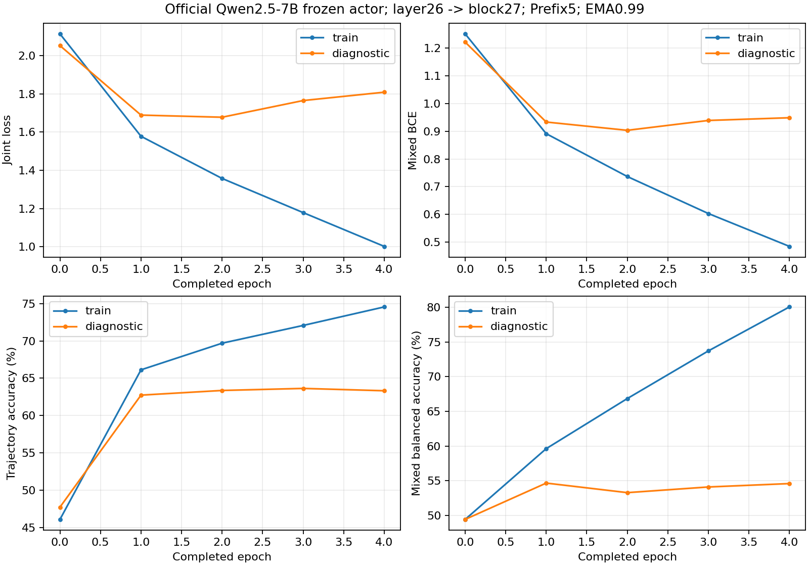

# Four-epoch native7B probe warmup and unseen selection

Newer direct human instruction changed the old20-epoch budget to FOUR complete epochs, then independent2048-question validation.
Actor remained frozen; source, all train/dev G5, native features, GPU restore proof and four complete Adam/EMA/RNG states accepted.
Original immutable config still states20 for checkpoint SHA compatibility; no20-epoch completion is claimed.

Actual completed requested updates:18292. Preserved graceful-stop epoch5 tail updates:4.
All artifacts and source data stay remote. The reserved51713 final questions were not used for fitting or selection.

# Four-checkpoint unseen NQ-dev selection validation

Identical2048 questions ×5 authentic trajectories, excluded from warmup and all old dev/final/stage splits.
Each EMA ranks predicted Mixed probability; true EM is used only afterwards. This is checkpoint selection validation.

| Epoch | True Mixed@512 | Fraction | Full2048 Mixed | Uplift (pp) |
|---|---:|---:|---:|---:|
| 1 | 169/512 | 33.0078% | 31.2988% | +1.7090 |
| 2 | 181/512 | 35.3516% | 31.2988% | +4.0527 |
| 3 | 177/512 | 34.5703% | 31.2988% | +3.2715 |
| 4 | 178/512 | 34.7656% | 31.2988% | +3.4668 |

Recommended EMA epoch: **2**. Exact ties prefer the earlier checkpoint.
Wilson intervals are descriptive; this selection validation is not an unbiased final seven-benchmark QA result.
All p_j, predicted q, same-trajectory EM and selected question identities remain on shared remote storage.

Recommended full checkpoint: `/data/user/jxu957/experiments/dynrpo-qwen25-7b-probe-warmup-20261019/probe/epoch-0002.pt`, weight key `ema`.

